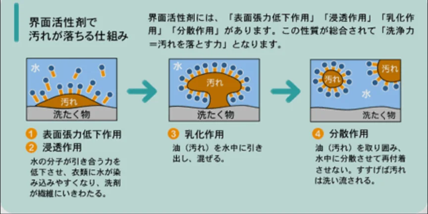

# 油脂と石鹸

- **油脂**は、グリセリン（C₃H₈O₃）に脂肪酸と呼ばれる酸が3つ結びついた構造を持つ有機化合物です。
    - バター・植物油・体脂肪などがこれにあたります。
- 脂肪酸には、飽和脂肪酸と不飽和脂肪酸があります。
    - **飽和脂肪酸**：常温で固体になりやすい（バター・ラード）
    - **不飽和脂肪酸**：常温で液体。酸化しやすい。（植物油・魚油）
- 油脂とアルカリ（水酸化ナトリウム）を合わせて作られるのが**石鹸**です。石鹸の分子は「水になじむ部分（図の青い部分）」と「油になじむ部分（図の黄色い部分）」の両方を持っており、これによって、油汚れを水で洗い落とすことができます。
    
    
    

- このような性質を持つ分子を**界面活性剤**と呼びます。洗剤・シャンプー・乳化剤はすべて界面活性剤の応用です。
