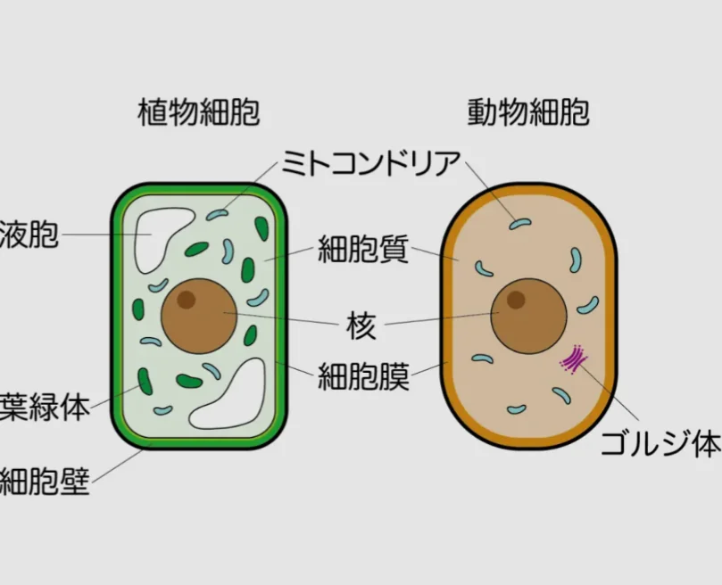

# 細胞の基本構造

- **細胞**は生命の基本単位です。ただし、動物と植物では、作りが少し異なります。
    
    
    

- まずは、動物細胞と植物細胞に共通する構造を見ていきます。
    - **核**は細胞のコントロールセンターで、**DNA**が収められています。
    - **ミトコンドリア**は「細胞の発電所」と呼ばれ、糖を分解してエネルギー（**ATP**）を生産します。
- 植物細胞にしかないものとしては、**葉緑体**（光合成を行う。これが緑色なので、植物は緑に見える）と、**細胞壁**（細胞膜の外側にある硬い壁。いわゆる食物繊維。**セルロース**でできている。）があります。
    - 葉緑体もミトコンドリアも、もともとほかの生物が取り込まれたものだと考えられており、独自のDNAを持ちます（細胞内共生）。
