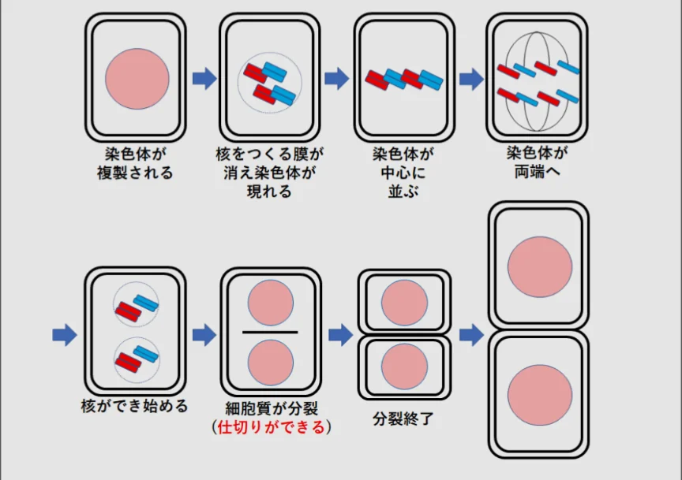
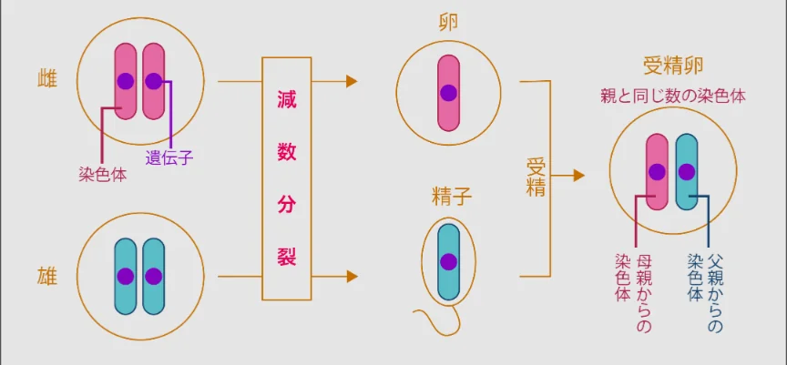

# 細胞分裂

- 細胞が増える仕組みが**細胞分裂**です。一つの細胞が分裂して二つになります。
- **体細胞分裂**は体を作る細胞（体細胞）が増えるときの分裂で、もとの細胞と同じDNAを持つ細胞が二つできます（DNAが複製されます）。
    - 傷の修復・成長・組織の維持に使われます。
    
    
    

- **減数分裂**は、精子や卵子（**生殖細胞**）を作るときの特別な分裂で、普通の細胞分裂とは異なり、染色体の数が半分になります。
    - **染色体**とは、DNAが折りたたまれた構造のことです。ヒトの染色体の数は46本なので、減数分裂をすることで、ヒトの精子（卵子）は23本ずつ染色体を持つことになります。
    - 受精すると、染色体の数は、父由来の23本と母由来の23本、合わせて46本になります。
    
    
    
