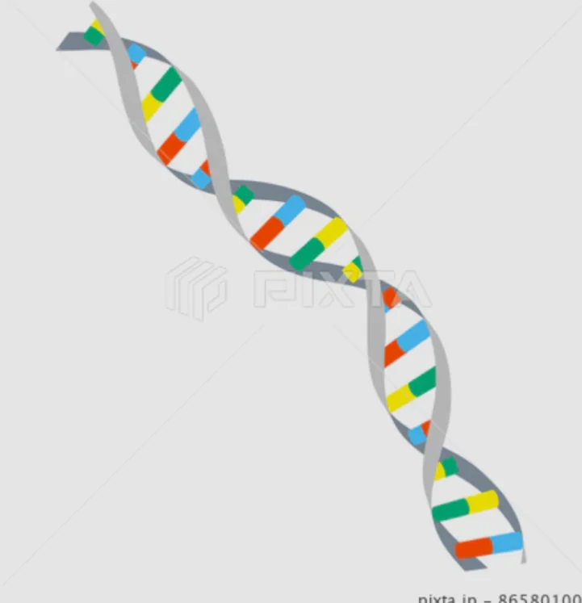

# DNAの構造と役割

- **DNA**は生命の設計図です。**塩基**と呼ばれる4種類の物質（アデニン（A）・チミン（T）・グアニン（G）・シトシン（C））による二本の鎖が螺旋状に巻かれた「**二重らせん**」構造をしています。
    - 二本の鎖はAとT、GとCが必ず対になって結びつく、という規則があります。そのため、2つの鎖のうち、一方の鎖があればもう一方を復元することができます。これによって、生物はDNAの複製や転写をすることができます（後述）。
        
        
        
- 塩基配列（塩基の組み合わせ）のうち、実際にタンパク質の情報をコードしている（実際に使われている）部分を**遺伝子**と呼びます。
    - 驚くことに、ヒトのDNAのうちタンパク質をコードする遺伝子は全体の約1.5%しかなく、残りの「使われていない領域」の役割は今も研究中です。
