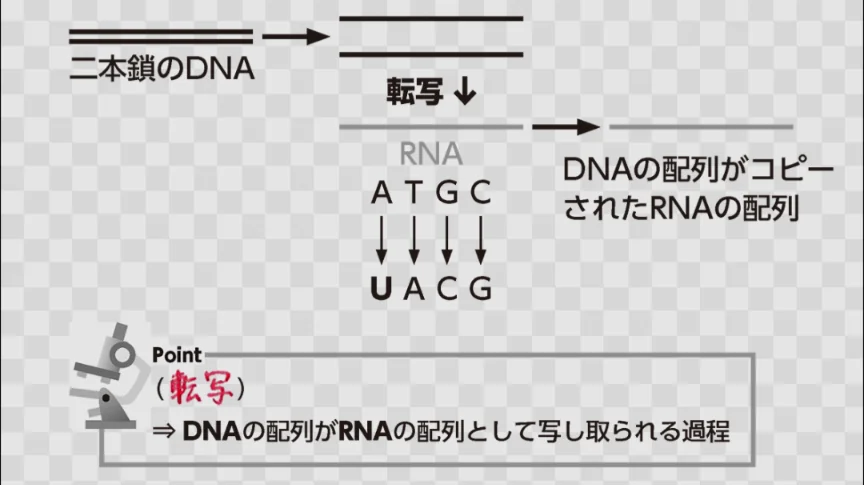

# タンパク質合成（転写・翻訳）

- DNAの情報がどのように体を作るのか（タンパク質になるのか）、という流れを**セントラルドグマ**と呼びます。
    - DNAの情報がコピー（転写）され、そのコピーを使ってタンパク質が作られる（翻訳）、という流れになります。
    
- DNAの情報を読み取って、**RNA**（DNAに似たもの。一本鎖）にコピーすることを**転写**といいます。
    - 転写をするために、まず二本鎖のDNAを剥がして一本鎖にします。この一本鎖の情報をもとに、DNAをコピーします。こうしてできたコピーを、**mRNA**（メッセンジャーRNA）と呼びます。
    
    
    
- mRNAができると、今度はその情報が読み取られて、タンパク質が作られていきます。これを**翻訳**といいます。
    - 塩基配列には、それぞれ固有の**アミノ酸**（タンパク質の原料）が対応しています。この組み合わせをもとに、それぞれに対応するアミノ酸をつなぎ合わせて、タンパク質を作成していきます。
        - アミノ酸は全部で20種類あり、どのアミノ酸をどの順番でつなぐかでタンパク質の形と機能が決まります。
- **タンパク質**は、酵素・ホルモン・筋肉・皮膚・髪など体のほぼすべての機能と構造を担っています。「DNAが体を作る」というのは、つまり「DNAがタンパク質の設計図になっている」ということです。
