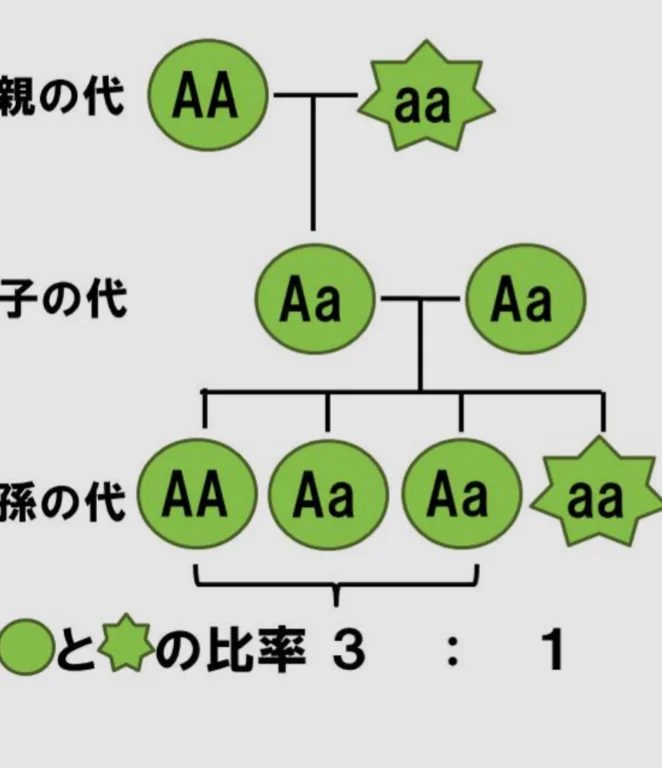

# 遺伝の法則

- **メンデル**はエンドウ豆を使った実験から**遺伝の法則**を発見しました。
- **実験**：メンデルは、丸い種と、シワのある種を持つエンドウを交配させました。
    - 丸とシワを交配（丸×シワ）させると第一世代（子ども）は、すべて丸い種になりました。
    - 第一世代同士を交配させると第二世代（孫）では、丸：シワ＝3：1になりました。
- **考察**：ここから分かることはなんでしょうか。種を丸くする遺伝子をA、種にシワをつける遺伝子を a としましょう（下図参照）。遺伝子は、父と母からそれぞれ1つずつ受け継ぐため、通常は1セット（2つ）存在します。そのため、丸い種が持っている遺伝子をAA（A2つ）、シワの種が持っている遺伝子をaa（a2つ）とします。
- 第一世代の持つ遺伝子としてあり得るのは、Aa（aA）のみですが、実験結果から、これは丸い種になっています。つまり、Aとaが両方ある場合は、Aが優先される、ということです。
- 第二世代は、Aa × Aaなので、あり得る組み合わせは、AA、Aa、aA、aaの4パターンです。丸とシワの比が 3 : 1 だったことを踏まえると、aaのときのみシワになった、と考えれば辻褄が合います。
    
    
    
- **結果**：これらの結果から分かる以下のことをまとめたものが**遺伝の法則**です。
    1. 生物の形質は遺伝によって決定されること
    2. 遺伝子の組み合わせはランダムで偏りがないこと
    3. 丸とシワのように、競合する遺伝子がある場合は、どちらかのみが優先されることがあること
