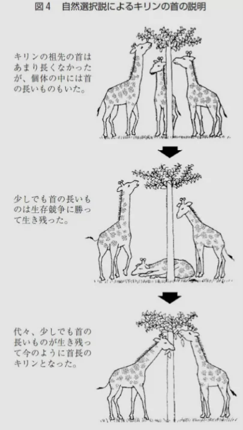

# 突然変異と進化への影響

- **突然変異**とは、DNAの塩基配列が変化することです。DNAのコピー（複製）は非常に正確ですが、完璧ではなく、ごくまれにミスが起きます。
    - 紫外線・放射線・特定の化学物質もDNAを傷つけて突然変異を起こします。
- 突然変異の多くは中立（何も変わらない）か、有害です。しかし、ごくまれに有利な変異が起きることがあります。
- 突然変異が生じた個体が、その環境で他の個体より多く子孫を残せるとき、その変異が集団に広まっていき、その遺伝子を持つ個体が多くなります。これが**自然選択**（自然淘汰）の仕組みです。この積み重ねによって、「**進化**」がおきます。
    - これが、**ダーウィン**が「種の起源」で発表した**進化論**です。
    
    
    
