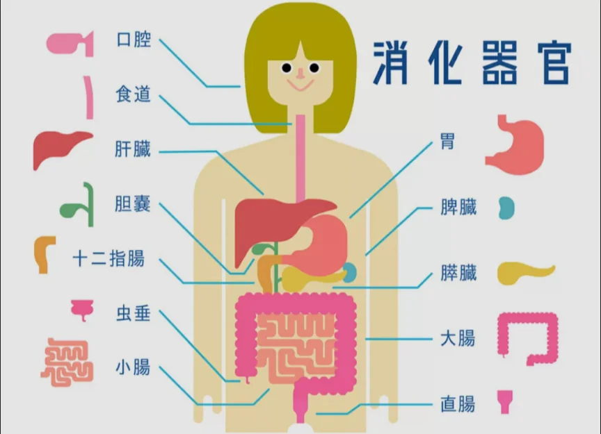

# 消化と吸収

- 食べ物を体が使える栄養素に分解して吸収するのが**消化器**の役割です。
    - 食べ物を分解（消化）する物質のことを**消化酵素**と呼びます。消化酵素は消化液（胃液など）に溶けています。
    
    
    
- 消化の経路は以下のようになっています。
    - **口**：唾液中の**アミラーゼ（**消化酵素**）**がデンプンを分解
    - **胃**：**ペプシン（**消化酵素**）**がタンパク質を分解。強酸（pH2）で細菌を殺す
    - **小腸**：**膵臓**から分泌される酵素（アミラーゼ・リパーゼ・プロテアーゼ）で糖・脂肪・タンパク質をさらに分解。小腸の壁から栄養素を吸収する
    - **大腸**：水分を吸収して便を作る
- 小腸は、内壁に**絨毛**（じゅうもう）という細かい突起が無数にあり、表面積を大きくして効率よく栄養を吸収します。
- 吸収された栄養素は、血液とリンパ管に入り、**肝臓**で代謝・貯蔵されてから全身に配られます。
