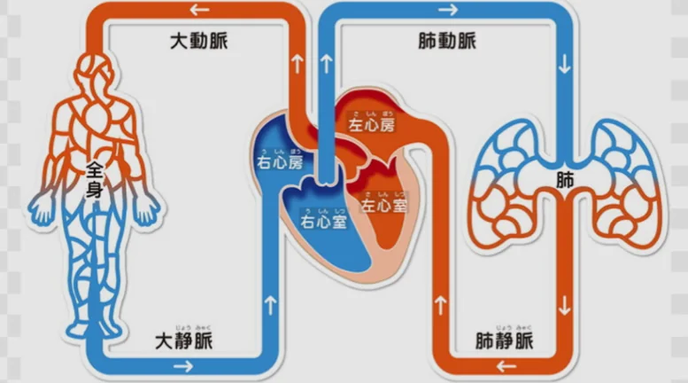

# 循環系（心臓と血液）

- 血液の循環には二つのルートがあります。
    - **体循環**：心臓→大動脈→全身の毛細血管→大静脈→心臓。酸素と栄養を全身に届け、CO₂と老廃物を回収します。
    - **肺循環**：心臓→肺→心臓。全身から回収してきたCO₂を肺で放出し、酸素を受け取ります。
    
    
    
- 血液の成分は以下のようになっています。
    - **赤血球**：**ヘモグロビン**というタンパク質で酸素を運ぶ。
    - **白血球**：免疫を担う。外来物（細菌・ウイルス）を攻撃する
    - **血小板**：出血時に集まって血を止める
    - **血漿**（けっしょう）：唯一の液体の成分。栄養素・ホルモン・老廃物を溶かして運ぶ
- **血液型**（ABO型）は赤血球表面の形（抗原）の種類のことです。抗原（後述）は、免疫反応に関わるものであるため、輸血時に型が合わないと、免疫反応が起きて大変危険です。そのため、血液型を正確に把握しておく必要があります。
