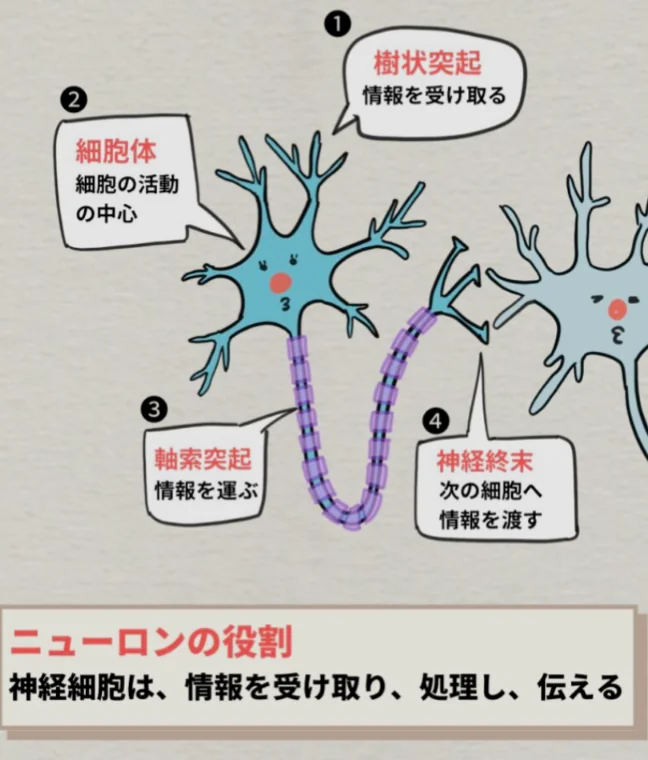

# 神経系と脳

- **神経系**は体内外の情報を収集・処理し、適切な反応を指令するシステムです。中枢神経と末梢神経からなります。
- **中枢神経**は、**脳**と**脊髄**からなり、情報処理の中心です。**末梢神経**は、中枢神経と全身をつなぐ役割を持ちます。
- 神経の基本単位は**ニューロン**（神経細胞）です。ニューロンは電気信号で他のニューロンに情報を伝えます。
    
    
    
- ニューロンとニューロンの接続部分を**シナプス**と呼び、ここでは電気信号が化学物質（**神経伝達物質**）に変換されて情報が渡されます。
    - ドーパミン・セロトニンは神経伝達物質の一種です。
    - **ドーパミン**は快楽などの報酬を得た際に出る神経伝達物質です。
    - **セロトニン**はドーパミンなどの暴走を抑えてリラックスさせる役割があります。
- **反射**は、脳を介さず脊髄レベルで行われる素早い反応です。熱いものに触れて手を引っ込める動作は、信号が脳まで到達する前に脊髄で処理されるため素早く起きます。
