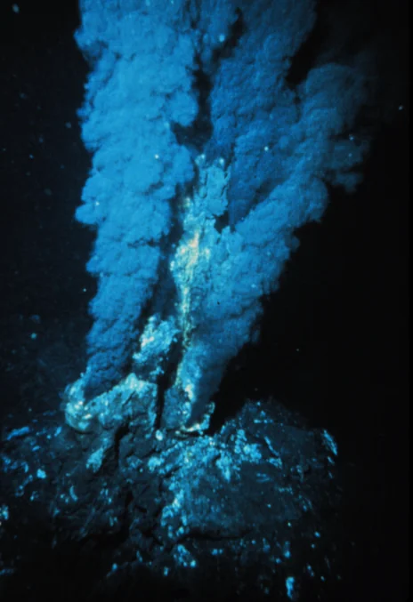

# 生命の起源

- 地球が誕生したのは約**46億年**前です。最初の細胞は約38億年前に誕生した原核細胞と考えられており、深海の**熱水噴出孔**のような環境が候補とされています。
    
    
    

- 生命がどのようにして誕生したかは完全には解明されていません。アミノ酸などの有機物が雷などのエネルギーを使って化学反応を起こし、長い時間をかけて、自己複製する分子を生み出したと考えられています。
