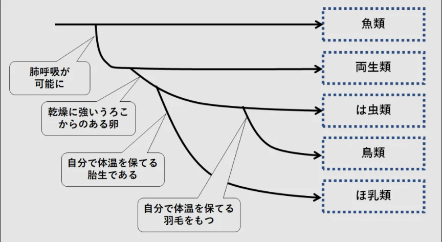

# 生物の進化の歴史

- 地球の生命は約38億年の時間をかけて劇的に変化してきました。
    - 約38億年前：最初の原核生物が誕生
    - 約5.4億年前：**カンブリア爆発**。動物の主要なグループがほぼ一斉に出現
    - 約3.7億年前：魚類から両生類が進化し陸上へ
    - 約700万年前：人類とチンパンジーの祖先が分岐
- 脊椎動物の中では魚類が最も古く、そこから両生類が派生しました。その後、両生類から爬虫類と哺乳類が進化しています。鳥類は爬虫類の一部（恐竜）が進化したものです。
    - 両生類はカエル、サンショウウオなど。
    - 爬虫類は、トカゲ、カメ、ヘビ、ワニなど。

