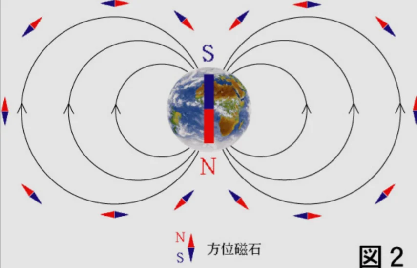

# 地球の誕生と構造

- 約**46億年**前、太陽系が形成される過程で、岩石からなる小さな惑星が衝突・合体を繰り返して、**地球**が誕生しました。
    - 誕生直後の地球は、衝突の熱で全体が溶けた「マグマの海」状態でした。
- 地球の半径は約**6400km**です。内側から、核（鉄）→**マントル**（岩石）→**地殻**（最外層）という層状構造を持ちます。
- 核によって、磁場（磁石のような力）が作られており、この磁場が**太陽風**（有害な粒子の流れ）から、地球をガードしています。
    
    
    
