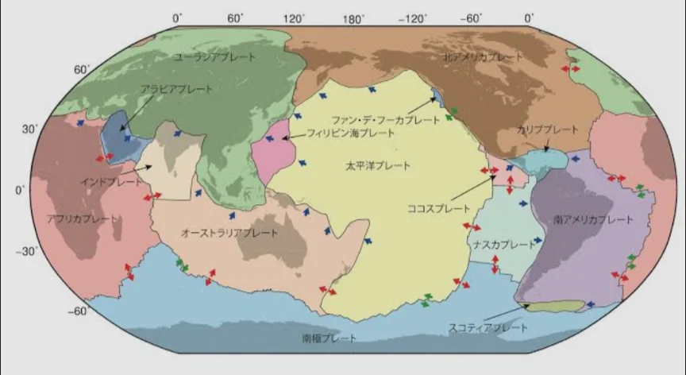
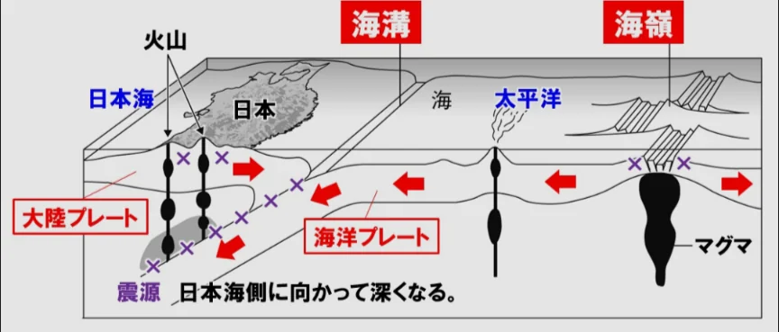
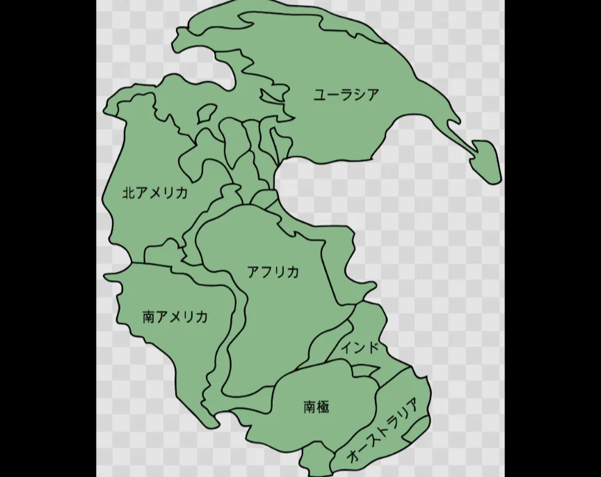

# プレートテクトニクス

- 地球の表面は十数枚の固い岩盤（**プレート**）で覆われており、それぞれがゆっくりと動いています。この考え方が**プレートテクトニクス**です。
    - プレートはマントルの対流に乗って動いています。
    
    
    
- プレートの境界では特徴的な現象が起きます。プレート同士が離れていく場所では、マントルが上昇して新しい海底が生まれます（**海嶺**=かいれい）。
- 逆に、プレートが衝突する場所では、海洋プレートが大陸プレートの下に沈み込みます（**海溝**）。
    - この沈み込みが火山・地震・海溝を生み出します。日本列島はまさにこの沈み込み帯に位置しています。
    
    
    
- 約2億5000万年前にはすべての大陸が一つに合体した**パンゲア**という超大陸があり、それが分裂して現在の大陸配置になりました。
    - アフリカの西海岸と、南米の東海岸は、ジグソーパズルのようにくっつけられそうな形をしていますが、それもそのはずで、もともと一緒だったものが、プレートテクトニクスによって分離したために現在のような形になっています。
    
    
    
