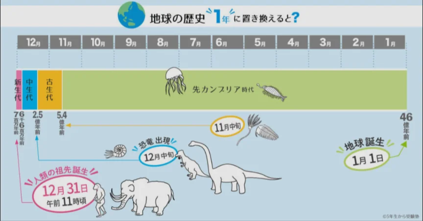

# 地球の歴史と地層

- **地層**は地球の歴史の記録です。砂・泥・火山灰などが水底に積もって固まることで作られ、下の層ほど古く、上の層ほど新しいという法則があります。
- 地層の年代を正確に測る方法が放射性年代測定です。**放射性同位体**（詳細は化学）は、一定の速さで壊れて別の物質に変わる性質があります。そのため、放射性同位体と崩壊後の物質の比率を測ることで、どのくらい時間が経ったかがわかります。

- 地球の歴史は、以下のように分かれます。
    
    
    

- **先カンブリア時代**（46億〜5.4億年前）
- **古生代**（5.4億〜2.5億年前）
    - **三葉虫**や**アノマロカリス**など。
- **中生代**（2.5億〜6600万年前）
    - **恐竜**や**アンモナイト**など。
- **新生代**（6600万年前〜現在）
    - **マンモス**や**サーベルタイガー**、人類など。
