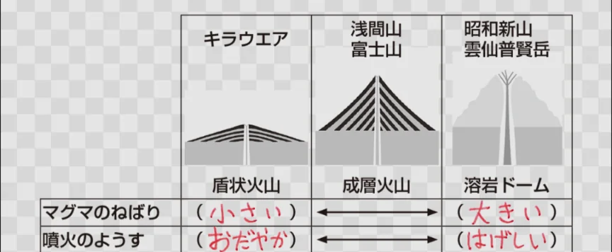

# 火山の仕組みと種類

- **マグマ**が生まれる場所は主に2か所あります。**プレート**と**ホットスポット**です。
- **ホットスポット**では、プレートに関係なくマントルが上昇しており、ハワイやアイスランドなどのものが有名です。
- 火山の形はマグマの粘り気（粘性）によって異なります。
    
    
    

- **火砕流**は高温の火山ガスと火山灰、岩が混合して高速（時速100km以上）で山の斜面を流れ下る現象で、火山災害で最も危険です。
    - 1991年の**雲仙普賢岳**の噴火では火砕流で43名が死亡しました。
