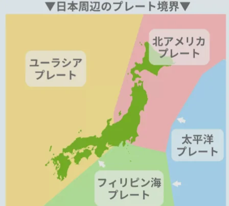

# 地震の仕組み

- **地震**は、プレートの動きによって蓄積されたひずみが一気に解放される現象です。岩盤が破壊されてずれる面を**断層**と呼びます。
- 日本は四枚のプレート（北米・ユーラシア・太平洋・フィリピン海）がぶつかり合う場所にあり、世界で最も地震が多い国の一つです。
    
    
    

- 地震の規模を表す**マグニチュード**（M）は、地震が放出するエネルギーの大きさです。
    - 2011年の東日本大震災はM9.0という観測史上日本最大の地震です。
