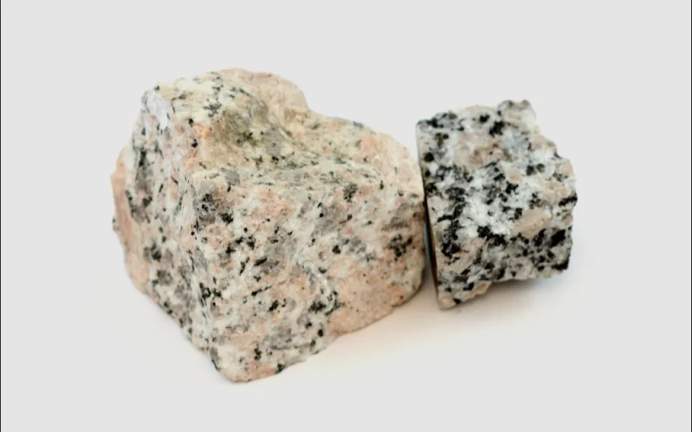
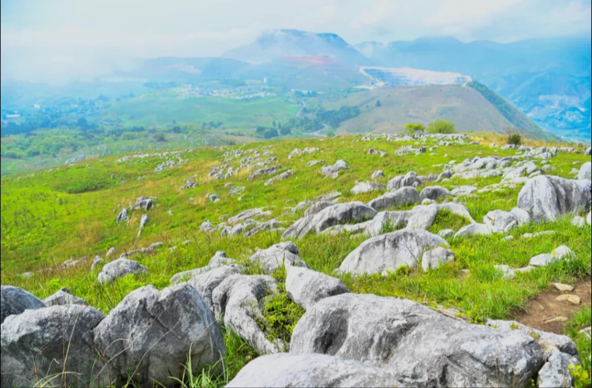

# 岩石の三種類

- 地球の岩石は成り立ちによって、いくつかの種類に分けられます。
- **火成岩**は、マグマが冷えて固まった岩石です。**玄武岩**（げんぶがん）や、**花崗岩**（かこうがん）などが有名で、花崗岩は墓石や建築材によく使われる岩石です。以下は花崗岩です。
    
    
    

- **堆積岩**は砂や生物の遺骸などが積もって固まった岩石です。**石灰岩**などがあります。
    - 石灰岩は、サンゴ・貝殻などの炭酸カルシウムが堆積したもので、海だった場所が隆起して山になる場合があり、日本の秋吉台（山口県）のような石灰岩台地（**カルスト地形**）や**鍾乳洞**を作ります。
    
    
    
- **変成岩**は既存の岩石が高温・高圧によって性質が変化した岩石です。**大理石**（石灰岩が変成）などがあります。
