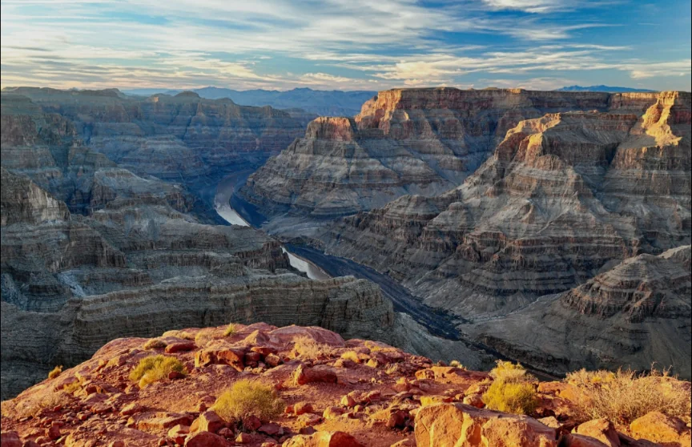
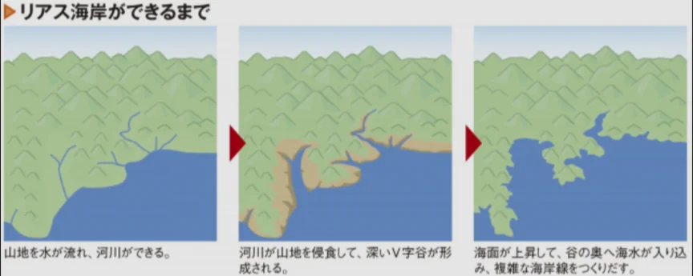
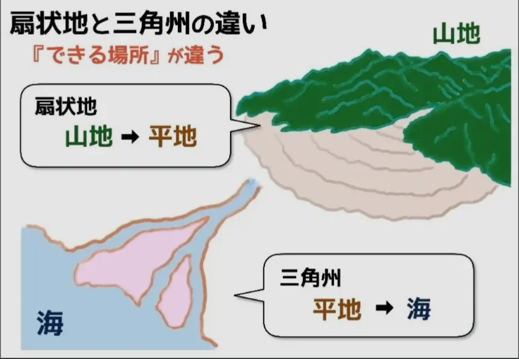
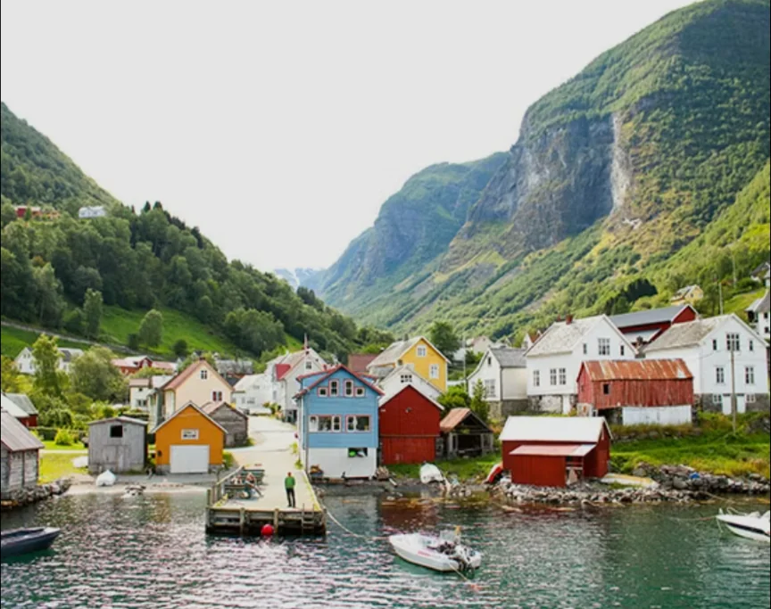

# 侵食・運搬・堆積

- **侵食**は岩石・地形が削られる現象です。主な担い手は雨水や波、氷河です。
    - **グランドキャニオン**は川が長年かけて岩盤を削った結果で、深さ約1600mの地層の断面に約20億年分の地球の歴史が刻まれています。
        
        
        
    - また、谷間が波などによって侵食されてできた海岸を**リアス海岸**と呼びます。東北の**三陸海岸**や長崎の大村湾などが有名です。
        
        
        
    
- **運搬**は侵食された物質が移動する過程です。下流ほど、物質の大きさは小さくなります。
- **堆積**（たいせき）は、運搬された物質が積もる過程です。川が海や湖に注ぐ場所では流速が落ちて土砂が堆積し、**三角州**（デルタ）を作ります。川が山間部から平地に出る場所では**扇状地**が形成されます。
    
    
    

- 氷河も強力な侵食力を持ちます。氷河によって昔削られた谷に、海水が入り込んだのが**フィヨルド**（ノルウェーやニュージーランドなど）です。
    
    
    
