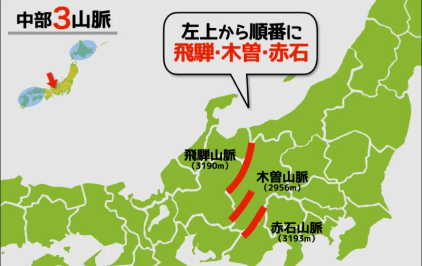
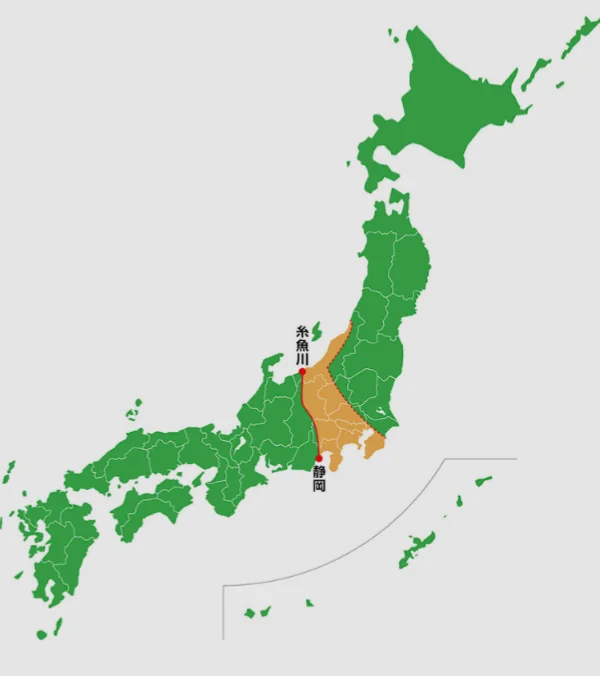

# 日本の地形の特徴

- 日本は、プレートの衝突によって地殻が押し上げられているため、山がちな地形をしています。
- 飛騨（ひだ）山脈・木曽（きそ）山脈・赤石山脈（まとめて**日本アルプス**）には、3000m級の山々が連なります。
    
    
    

- **フォッサマグナ**は本州を東西に分ける溝で、地質学的にまったく異なる東日本と西日本を分ける境界線です。以下の黄色い部分です。
    
    
    
