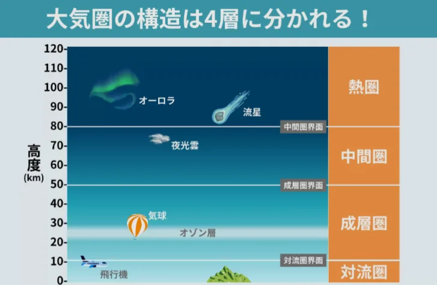

# 大気の構造

- 地球を包む大気は高度によって、いくつかの層に分けられます。
    
    
    
- **対流圏**：私たちが生きる大気の層で、大気全体の質量の約80%が集中しています。天気にまつわる現象はすべてここで起きます。
- **成層圏**：**オゾン層**のある層です。オゾン層は、太陽から降り注がれる紫外線を吸収する層で、1980年代から、これに穴が空いた**オゾンホール**が確認され、環境問題になりました。
