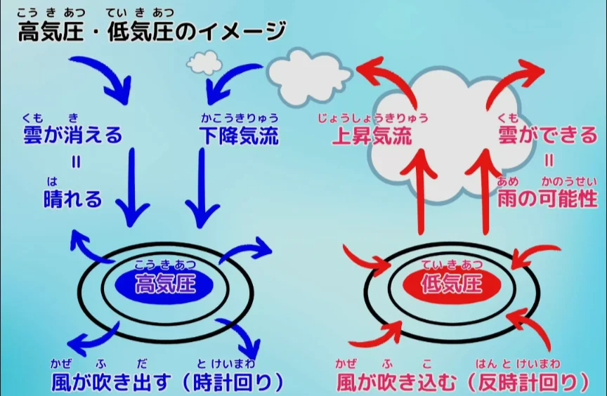
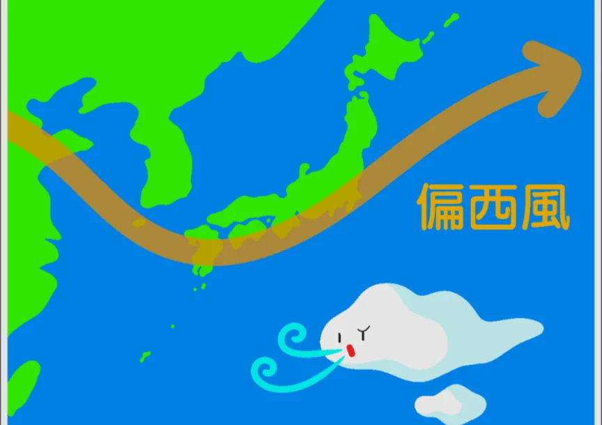

# 気圧と風

- **気圧**とは、単位面積あたりに大気が押す力（圧力）です。標準的な気圧は、**1013hPa**（ヘクトパスカル）で、約1kgの物体が1cm²を押す力に相当します。
    - 私たちは常に上から約1トン/m²の大気に押されていますが、体の内側からも同じ圧力で押し返しているため感じません。
- **高気圧**は周囲より気圧が高い場所です。空気が下降することで雲が消えて晴れになります。**低気圧**は逆に中心に向かって風が吹き込み、上昇気流で雲が発生して悪天候になります。
    - 風は気圧の差によって高いところから低いところへ吹きます。そのため、気圧が分かれば風向が分かります。
        
        
        

- **偏西風**は中緯度帯で西から東に向かって常に吹く風です。日本の天気が西から変わる理由がこれで、天気予報で「明日は西から雨雲が接近」というのは偏西風に乗って雲が移動するためです。
    
    
    
