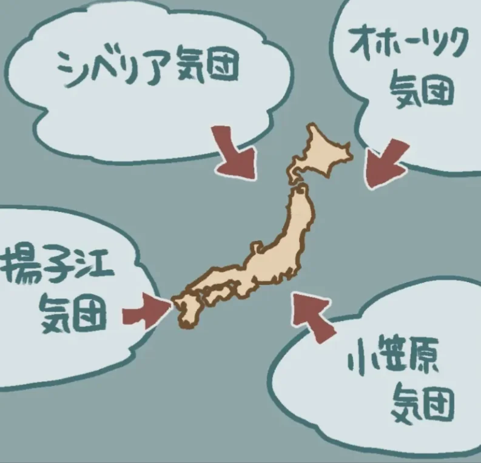
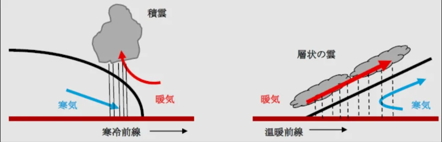
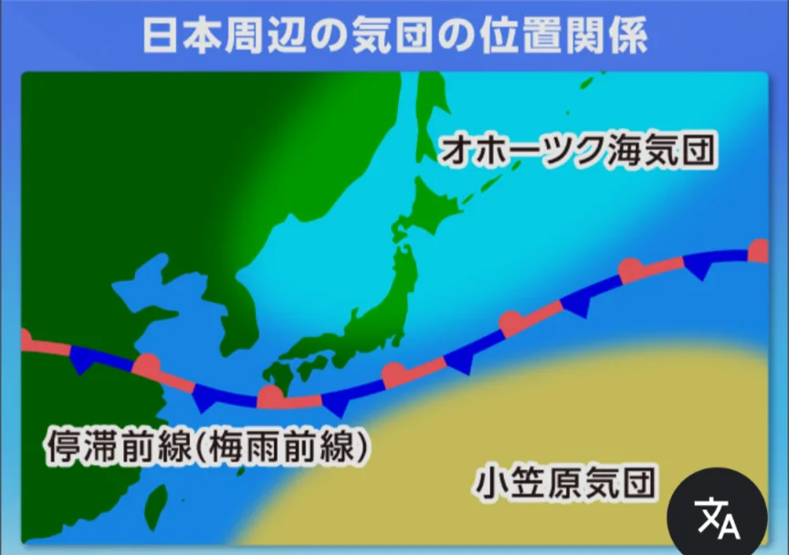

# 前線と天気の変化

- **気団**とは、大規模な空気のかたまりのこと（高気圧）です。日本に影響する気団としては、冷たく乾燥した**シベリア気団**・冷たく湿った**オホーツク海気団**・暖かく湿った**小笠原気団**などがあります。
- 冬に勢力を伸ばすのがシベリア気団、夏に勢力を伸ばすのが小笠原気団です。
    
    
    

- 性質の異なる気団がぶつかる境界面を**前線**と呼びます。**温暖前線**は暖かい空気が冷たい空気の上にゆっくり乗り上げる前線です。穏やかな雨が長時間続きます。
    - 天気予報で「明日から雨が続く」という場合は温暖前線の接近が多いです。
- **寒冷前線**は冷たい空気が暖かい空気の下に急激にもぐりこむ前線です。前線通過時に強い雨・雷・突風が短時間で起きます。

- **梅雨前線**はオホーツク海気団と小笠原気団がぶつかって生じる**停滞前線**で、6〜7月に日本付近に停滞します。どちらの気団も勢力が拮抗しているため前線が動かず長雨になります。
    
    
    
