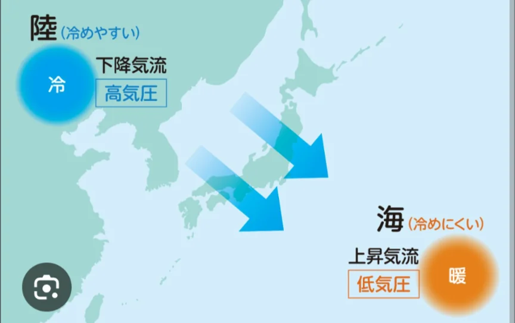
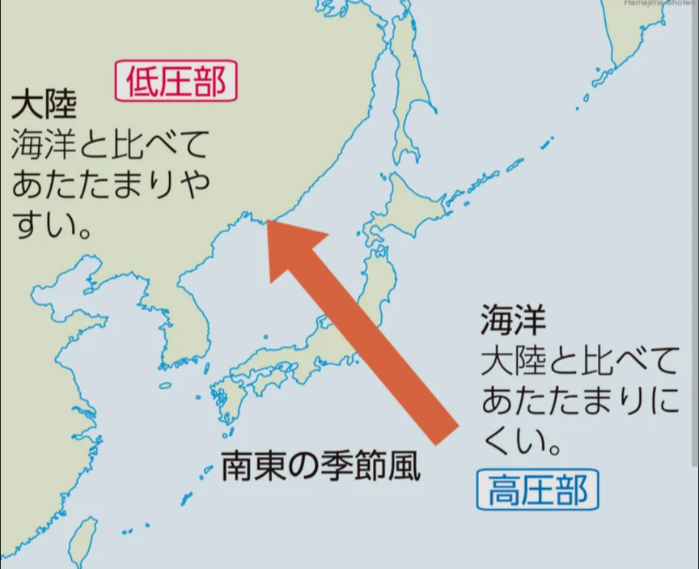

# 日本の気候と季節風

- 日本海側と太平洋側では、気候が大きく異なります。季節によって向きが異なる風のことを、**季節風**と呼びます。
- **冬**：シベリア気団から、冷たい北西の風が吹きます。日本海を通って水分を蓄えた風が日本アルプスなどの山脈にぶつかって日本海側に大雪を降らせます。山を越えた後は、水分を失って乾燥した「からっ風」として太平洋側に吹き下ろします。これが太平洋側が冬に晴れて乾燥する理由です。
    
    
    

- **夏**：太平洋の小笠原気団から暖かく湿った南東の風が吹きます。日本の夏がジメジメするのはこのためです。太平洋側に雨をもたらし、山を越えた後は日本海側は晴れる傾向があります。
    
    
    

- **台風**は熱帯の海上で発生した低気圧のうち、最大風速が約17m/s以上になったものです。
