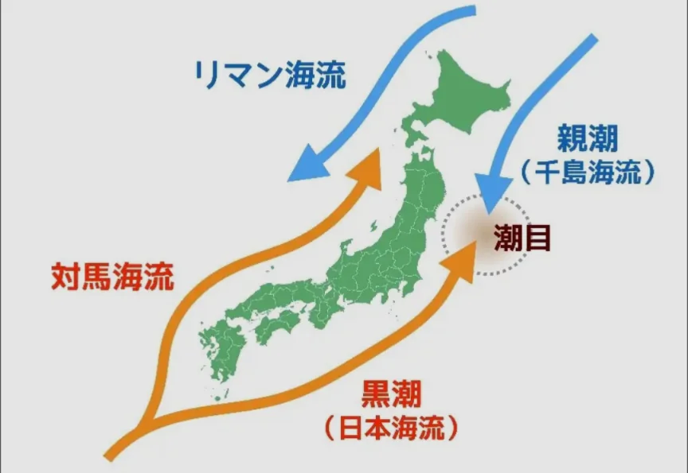
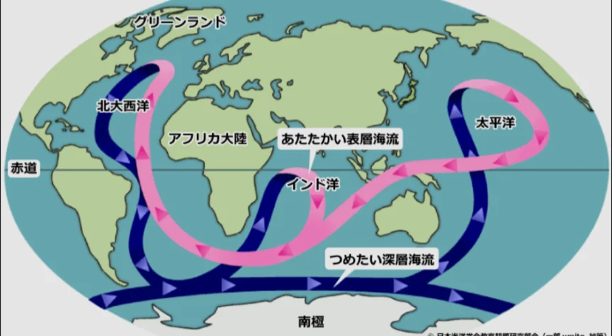

# 海流と気候への影響

- 海は地球表面の約7割を覆っています。
- 日本付近の主な海流はいくつかあります。**黒潮**（日本海流）は太平洋を北上する暖流です。
- **親潮**（千島海流）は北から南下する寒流で、豊富な養分を含み、プランクトンが多く魚が豊富です。
    - 暖流と寒流がぶつかる場所（**潮目**）は魚が集まる好漁場になります。三陸沖は黒潮と親潮がぶつかる世界的な漁場です。
        
        
        
- 海流が気候に影響を与える最も有名な例が、ヨーロッパを温める北大西洋海流です。ロンドンは北海道より高緯度にあるにもかかわらず、冬でも比較的温暖ですが、それはこの海流のおかげです。
    
    
    
