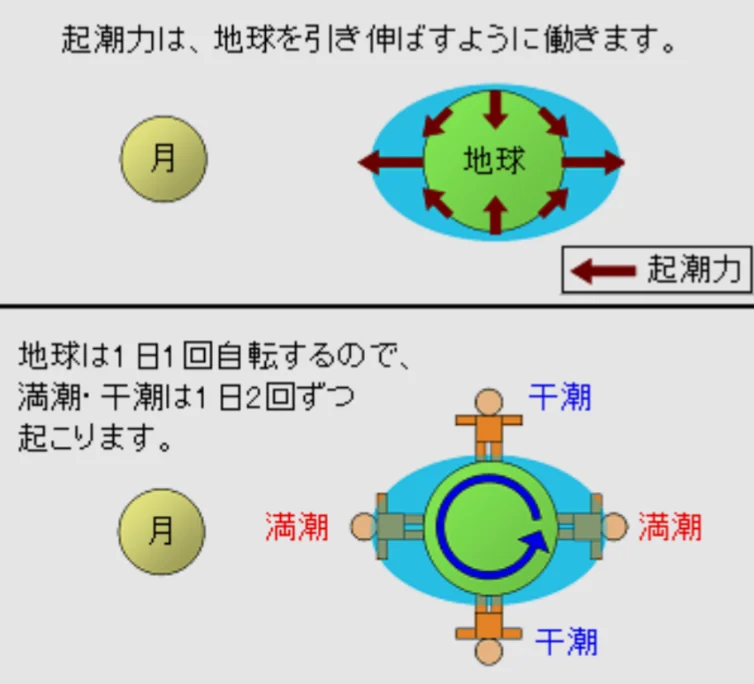
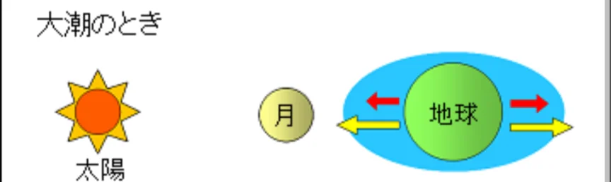

# 潮汐（潮の満ち引き）

- 海面が定期的に上昇・下降する現象を**潮汐**（ちょうせき）と呼びます。約6時間ごとに満潮と干潮を繰り返します。
- 潮汐の主な原因は月の引力です。月に近い側の海水は月に引き寄せられて盛り上がり（**満潮**）、その反対側も地球が月に引っ張られて海水が取り残された形で盛り上がります。月から遠い両サイドが**干潮**になります。
    
    
    
- **大潮**は太陽・月・地球が一直線に並ぶとき（新月・満月の前後）に、月と太陽の引力が重なって潮位の差が最大になる現象です。
    
    
    
