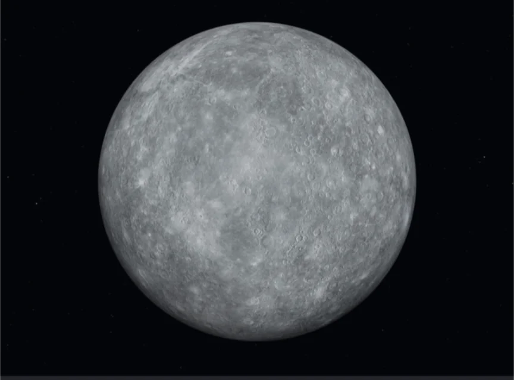
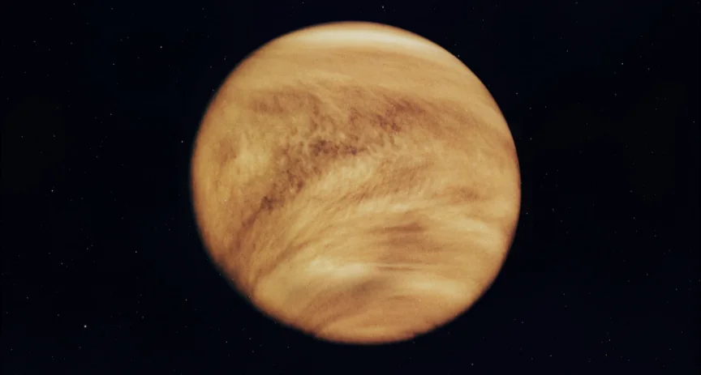
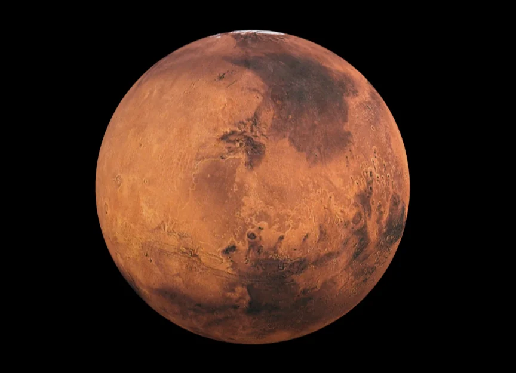
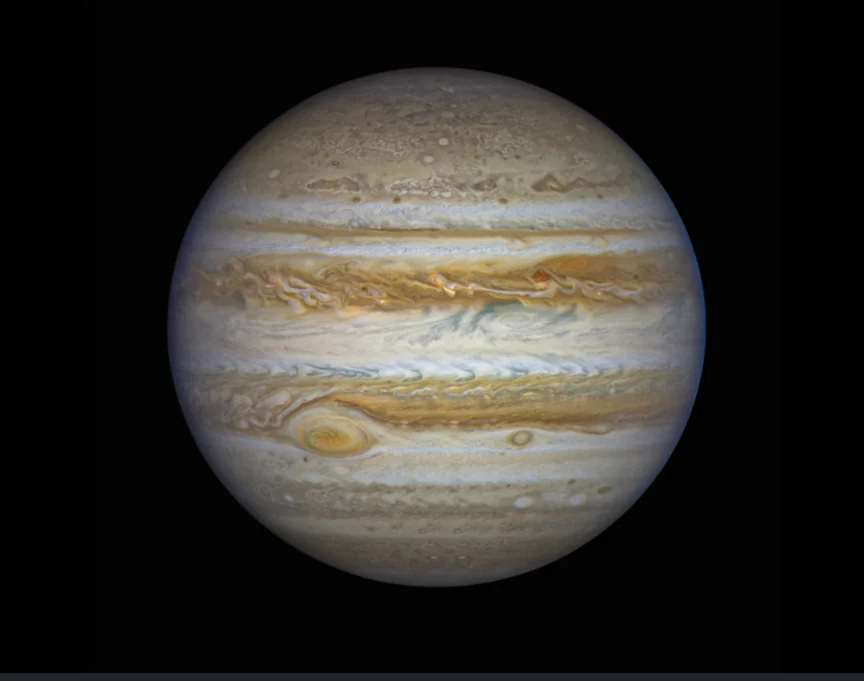
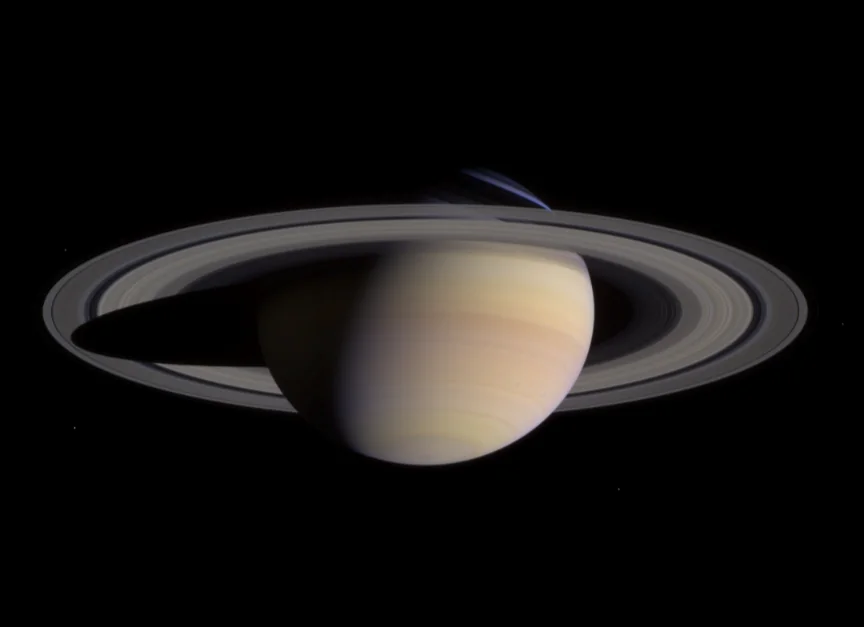
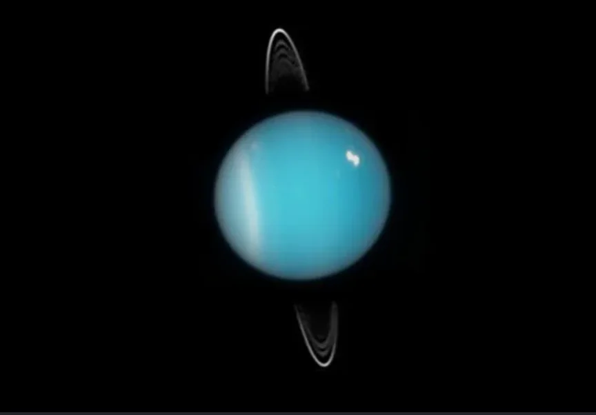
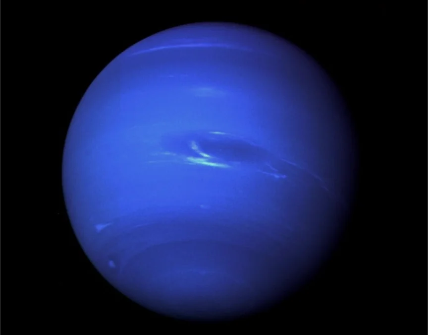

# 太陽系の構造

- **太陽系**は、太陽とその重力に捕らえられた天体の集まりです。中心の太陽が太陽系全体の質量の約99.86%を占めています。
- 八つの惑星は内側から、以下のように並んでいます。
    - **水星**（最も小さい）
        
        
        
    - **金星**
        - 温室効果ガスによって灼熱になり、酸の雨が降る。明け方に見える金星は**明けの明星**（みょうじょう）、夕方に見える金星は**宵の明星**と呼ばれる。地球から最も明るく見える惑星。
        
        
        
    - 地球
    - **火星**
        
        
        
    - **木星**（最も大きい。ガスでできている）
        
        
        
    - **土星**（輪っかが有名。ガス。）
        
        
        
    - 天王星
        
        
        
    - 海王星
        
        
        
        - **冥王星**は、2006年に惑星から「準惑星」に格下げされました。
