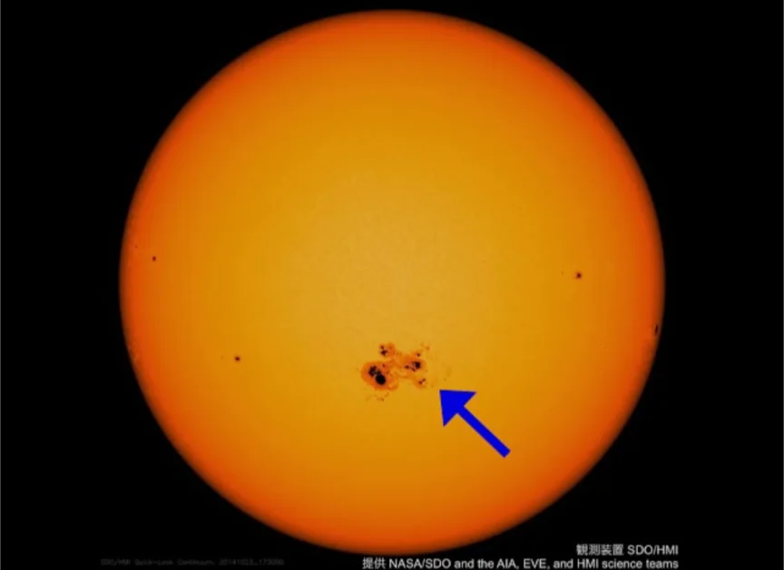

# 太陽の構造と活動

- 太陽は**恒星**（自ら光を出す天体）で、質量は地球の約33万倍です。
    - 太陽は、東から昇り、南を通って（**南中**）、西に沈んでいきます。
    - 月や金星などは、太陽からの光を反射して明るく見えているだけで、恒星ではありません。
- 太陽のエネルギー源は中心部での**核融合反応**です。水素を燃料としてエネルギーを生み出しています。
- 太陽表面に見える黒い点を**黒点**と呼びます。磁場が強く、周囲より温度が低いため暗く見えます。
    
    
    
- **太陽フレア**は、太陽表面で起きる大規模な爆発で、太陽風が地球に降り注ぐことで通信障害・停電・オーロラの増加を引き起こします。
