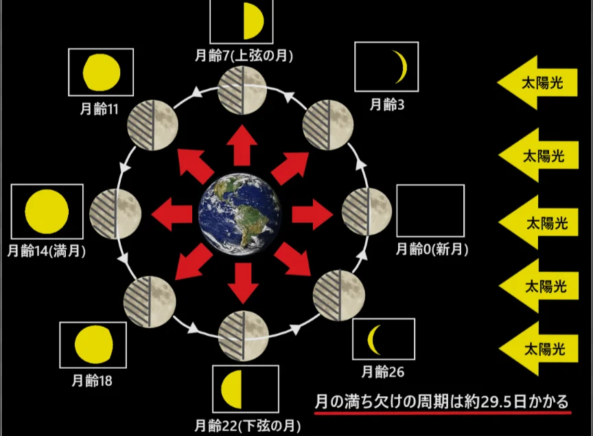
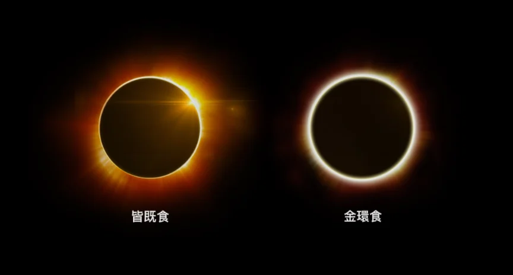
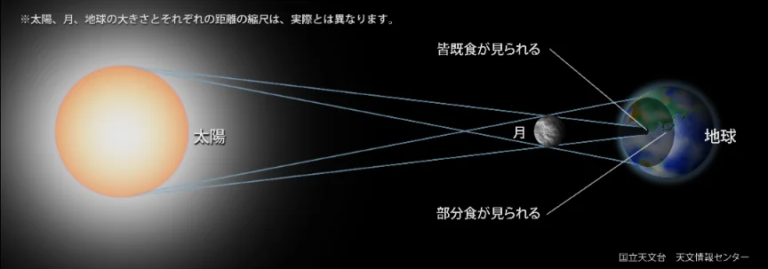
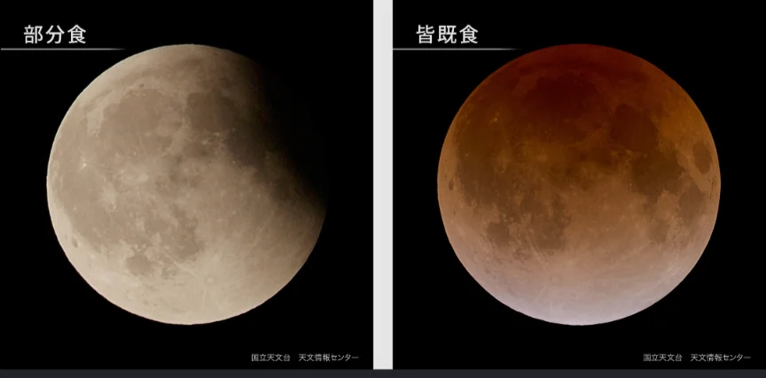
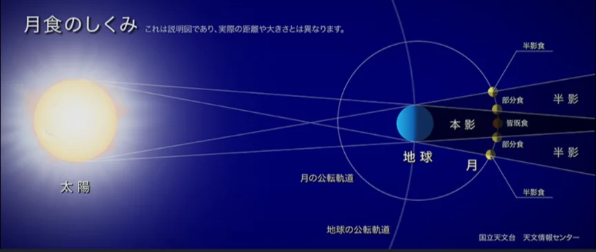

# 月と地球の関係

- **月**は、地球の唯一の衛星です。直径は地球の約4分の1です。
- 月の満ち欠けは、月が地球の周りを**公転**する過程で、太陽・地球・月の位置関係が変わることによって起きます（下図参照）。
    - 月が太陽の反対側にあるときは満月になります。逆に言うと、満月を観察する際は、太陽の反対側にいないといけないので、夜しか見えません。逆に、新月は昼しか見えません。
    - **月齢**は、新月を0としたときに、今が何日目の月かを表す概念です。月齢3の月が**三日月**です。月齢15が満月で、その夜は**十五夜**と呼ばれます。
    
    
    
- **日食**は月が太陽を隠す現象です。月と地球の位置関係によって、**皆既日食**（太陽を完全に隠す）や部分日食（部分的に隠れる）、**金環日食**などになります。
    
    
    
    
    

- **月食**は地球の影に月が入る現象です。完全に真っ暗にはならず、赤く見えます。
    
    
    
    
    
