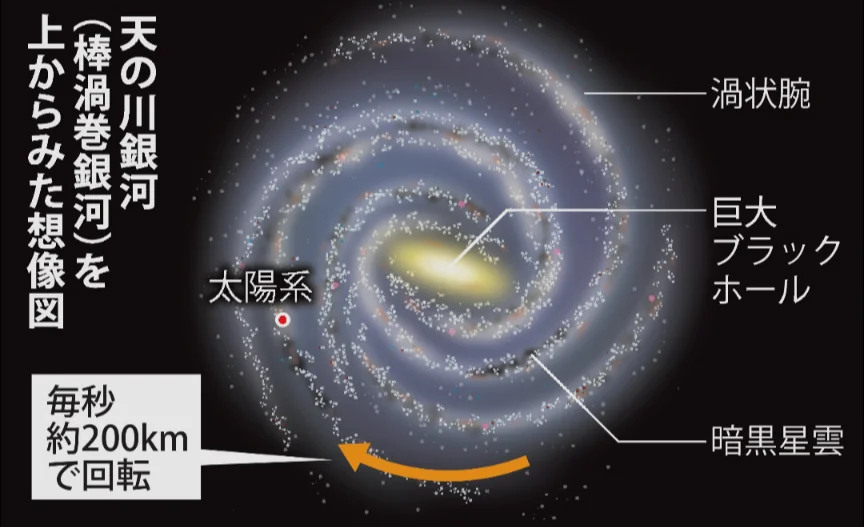

# 恒星と銀河

- 夜空に輝く星は、すべて太陽と同じ**恒星**です。太陽の8倍以上の質量の星は、寿命の最後に**超新星爆発**を起こします。残った中心部は**ブラックホール**になることがあります。
    - 金・銀・ウランなど鉄より重い元素は超新星爆発によって生み出されています。私たちの体を作る元素の多くは、かつて爆発した星が作ったものです。
- **天の川銀河**は太陽を含む約2000億個の恒星が集まった銀河で、直径約10万光年のうずまき状をしています。
    - 1光年は、光が1年で進む長さのことです。
    
    
    
