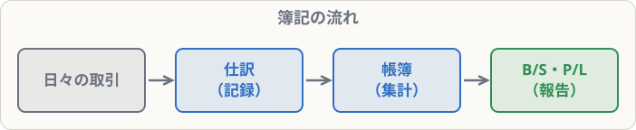

# 簿記とは・簿記3級の試験

## まず覚えること

- 簿記とは、会社のお金やモノの動きを、**決まったルールで帳簿に記録する技術**。
- 記録の最終目的は、**貸借対照表（B/S）** と **損益計算書（P/L）** という2つの表を作ること。
- 日商簿記3級は **60分・100点満点・70点以上で合格**。第1問の **仕訳15問（45点）** が最大の得点源。

## 簿記は何のためにあるのか

お店や会社は、毎日たくさんの取引をしています。商品を仕入れる、売る、給料を払う、家賃を払う……。これをただメモしていくだけでは、

- 今、会社にお金やモノがどれだけあるのか
- この1年で、結局いくらもうかったのか

がすぐにはわかりません。そこで、**すべての取引を同じルールで記録し、最後に2つの表にまとめる**仕組みが生まれました。それが簿記です。

| 表 | わかること | たとえると |
|---|---|---|
| 貸借対照表（B/S） | ある日の**財産の状態**（何をいくら持っていて、借金はいくらか） | 会社の「健康診断の結果」 |
| 損益計算書（P/L） | ある期間の**もうけ**（いくら稼いで、いくら使ったか） | 会社の「1年間の成績表」 |

この2つの表は、経営者だけでなく、お金を貸す銀行、株を買う投資家、税金を計算する税務署なども見ます。**誰が見ても同じように読めるように、記録のルールが決まっている**のです。

## 簿記3級で学ぶ範囲

3級は、**小規模な株式会社**の取引を記録する方法を学びます。内容は大きく3つです。

1. **日々の取引の記録**：現金、預金、商品の売り買い、固定資産、給料、税金など（第2〜7章）
2. **帳簿のつけ方**：補助簿、伝票（第8〜9章）
3. **決算**：1年の終わりに記録を整理し、B/SとP/Lを作る（第10〜12章）

## 試験の形式（2026年時点）

| 項目 | 内容 |
|---|---|
| 試験時間 | 60分 |
| 満点・合格点 | 100点満点、**70点以上で合格** |
| 受け方 | ネット試験（テストセンターで随時）／統一試験（年3回の会場試験） |
| 第1問 | **仕訳15問（45点）**：1問3点 |
| 第2問 | 補助簿・勘定記入・語句などから2問（20点） |
| 第3問 | **決算の問題**：精算表・財務諸表・決算整理後残高試算表など（35点） |

> 合格の戦略は「第1問で40点以上、第3問で25点以上を取り、第2問で残りを取る」。仕訳ができれば、第2問も第3問も解けるようになります。**この科目でもまず仕訳を完璧にすること**を目標にします。

## 勉強のコツ

- **読むだけでなく、手を動かす**。仕訳の例は、隠して自分で書いてから答えを見る。
- **勘定科目の「ホームポジション」**（左か右か）を最初に覚える（BK01-03で学びます）。
- 電卓は試験に持ち込めます。慣れておきましょう。
