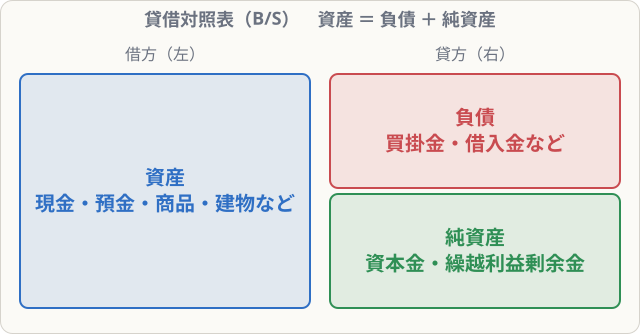
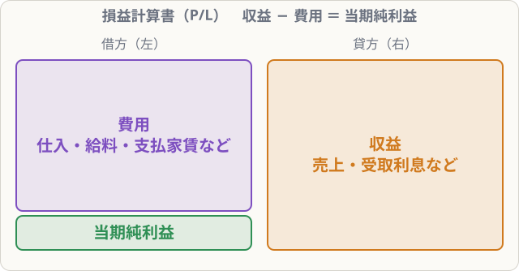

# 貸借対照表と損益計算書（5つの要素）

## まず覚えること

- 簿記の言葉はすべて、**資産・負債・純資産・収益・費用**の5つのグループのどれかに入る。
- **貸借対照表（B/S）**：左に資産、右に負債と純資産。**資産 ＝ 負債 ＋ 純資産**。
- **損益計算書（P/L）**：左に費用、右に収益。**収益 − 費用 ＝ 当期純利益**。

## 5つの要素

| 要素 | 意味 | 例（勘定科目） |
|---|---|---|
| **資産** | 会社が持っている財産・権利（プラスの財産） | 現金、普通預金、売掛金、商品、建物、土地 |
| **負債** | 将来払わなければならない義務（マイナスの財産） | 買掛金、借入金、未払金 |
| **純資産** | 資産から負債を引いた、会社自身の持ち分 | 資本金、繰越利益剰余金 |
| **収益** | もうけのもとになる収入 | 売上、受取利息、受取手数料 |
| **費用** | 収益を得るために使ったお金 | 仕入、給料、支払家賃、水道光熱費 |

**勘定科目**とは、取引を記録するときに使う「見出し」のことです。「現金」「売上」などの名前を、決められたとおりに使います。

## 貸借対照表（B/S）：ある日の財産の状態

左側（**借方**）に「何を持っているか（資産）」、右側（**貸方**）に「そのお金をどうやって集めたか（負債・純資産）」を書きます。

たとえば、自分のお金100万円と銀行からの借金50万円で会社を始め、全部を預金に入れたとします。

- 資産：預金 150万円
- 負債：借入金 50万円（返す必要があるお金）
- 純資産：資本金 100万円（返す必要のない、自分のお金）

左右の合計は必ず一致します。**資産 ＝ 負債 ＋ 純資産**。これを**貸借対照表等式**といいます。左右がつり合う（バランスする）ので、英語でバランスシート（B/S）と呼ばれます。

## 損益計算書（P/L）：ある期間のもうけ

左側に**費用**、右側に**収益**を書きます。収益の方が大きければ、その差が**当期純利益**（もうけ）です。費用の方が大きければ**当期純損失**になります。

> 例：1年間の売上 500万円、仕入や給料などの費用 420万円 → 当期純利益 80万円

## 2つの表のつながり

P/Lで出た当期純利益は、B/Sの純資産（**繰越利益剰余金**）を増やします。「もうかった分だけ、会社自身の持ち分が増える」ということです。この関係は第12章でくわしく学びます。

## 覚え方のコツ

- **B/Sは「持ち物（左）と、その出どころ（右）」**。
- **P/Lは「使ったお金（左）と、稼いだお金（右）」**。
- 5要素の左右の位置は、次の単元で学ぶ「仕訳のルール」にそのままつながります。ここは必ず覚えましょう。

| 表 | 左（借方） | 右（貸方） |
|---|---|---|
| B/S | 資産 | 負債・純資産 |
| P/L | 費用（＋当期純利益） | 収益 |
