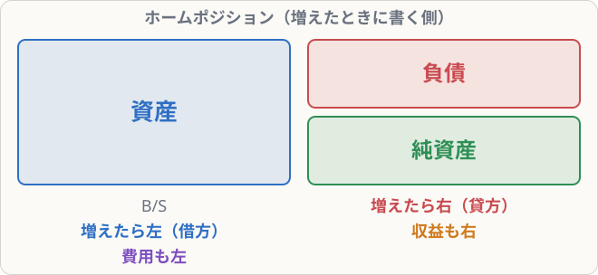

# 仕訳のルール（借方と貸方）

## まず覚えること

- **仕訳**とは、取引を **借方（左）** と **貸方（右）** に分けて、勘定科目と金額で記録すること。
- 5要素には**ホームポジション（増えたときに書く側）**がある。**資産・費用は左、負債・純資産・収益は右**。減ったときは反対側に書く。
- 1つの仕訳の**左の合計と右の合計は必ず一致**する。

## なぜ左右に分けるのか

取引には、必ず**原因と結果の2つの面**があります。

> 例：銀行から現金100,000円を借りた
> - 現金（資産）が100,000円**増えた**
> - 借入金（負債）が100,000円**増えた**

この2つの面を、左右に分けて同時に記録するのが簿記（正確には**複式簿記**）です。2つの面を記録するので、後で計算ミスがあっても左右の合計が合わずに気づけます。

## ホームポジション

前の単元のB/S・P/Lの形を思い出してください。**各要素が表のどちら側にあるか**が、そのまま「増えたときに書く側」になります。

| 要素 | 増えたら | 減ったら |
|---|---|---|
| 資産 | **借方（左）** | 貸方（右） |
| 負債 | **貸方（右）** | 借方（左） |
| 純資産 | **貸方（右）** | 借方（左） |
| 収益 | **貸方（右）** | （ほぼ出てこない） |
| 費用 | **借方（左）** | （ほぼ出てこない） |

## 仕訳の手順（4ステップ）

1. 取引で**動いた勘定科目**を2つ以上見つける
2. それぞれが**5要素のどれか**を考える
3. **増えたか減ったか**を考える
4. ホームポジションに従って左右に書き、金額を入れる

### 例1：銀行から現金100,000円を借りた

- 現金（資産）が増えた → 左
- 借入金（負債）が増えた → 右

| 借方科目 | 金額 | 貸方科目 | 金額 |
|---|--:|---|--:|
| 現金 | 100,000 | 借入金 | 100,000 |

### 例2：商品50,000円を仕入れ、代金は現金で支払った

- 仕入（費用）が発生した → 左
- 現金（資産）が減った → 右

| 借方科目 | 金額 | 貸方科目 | 金額 |
|---|--:|---|--:|
| 仕入 | 50,000 | 現金 | 50,000 |

### 例3：商品を80,000円で売り、代金を現金で受け取った

- 現金（資産）が増えた → 左
- 売上（収益）が発生した → 右

| 借方科目 | 金額 | 貸方科目 | 金額 |
|---|--:|---|--:|
| 現金 | 80,000 | 売上 | 80,000 |

### 例4：借入金のうち30,000円を現金で返した

- 借入金（負債）が減った → 左（ホームの反対）
- 現金（資産）が減った → 右

| 借方科目 | 金額 | 貸方科目 | 金額 |
|---|--:|---|--:|
| 借入金 | 30,000 | 現金 | 30,000 |

## 「借方・貸方」という名前について

「借りる」「貸す」という意味は、今ではほとんど関係ありません。**ただの「左」「右」の呼び名**だと思ってください。

## 覚え方のコツ

- ひらがなで書くと、「かり**かた**」の「り」は左にはらう → **左**、「かし**かた**」の「し」は右にはらう → **右**。
- 「**資産と費用は左**、それ以外は右」と1つだけ覚えれば、残りは自動的に決まります。
- 迷ったら、**現金がどう動いたか**から考えると簡単です。現金が増えたら左、減ったら右。
