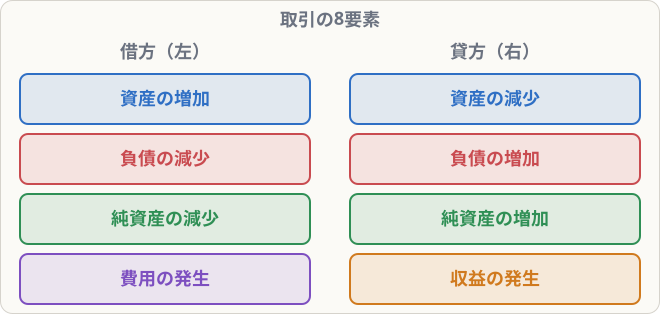

# 取引の8要素と仕訳の練習

## まず覚えること

- 仕訳の左には「資産の増加・負債の減少・純資産の減少・費用の発生」、右には「資産の減少・負債の増加・純資産の増加・収益の発生」がくる。これを**取引の8要素**という。
- **簿記上の取引**は、資産・負債・純資産・収益・費用が**増減するもの**だけ。契約しただけ・注文を受けただけは取引にならない。
- 火災や盗難のように、普通の言葉では取引と言わなくても、**財産が減れば簿記上の取引**になる。

## 取引の8要素

左側の4つのどれか ＋ 右側の4つのどれか、の組み合わせで、すべての仕訳ができています。

| 例 | 左（借方） | 右（貸方） |
|---|---|---|
| 現金で備品を買った | 資産の増加（備品） | 資産の減少（現金） |
| 現金を借りた | 資産の増加（現金） | 負債の増加（借入金） |
| 借金を現金で返した | 負債の減少（借入金） | 資産の減少（現金） |
| 株式を発行して現金を受け取った | 資産の増加（現金） | 純資産の増加（資本金） |
| 手数料を現金で受け取った | 資産の増加（現金） | 収益の発生（受取手数料） |
| 家賃を現金で払った | 費用の発生（支払家賃） | 資産の減少（現金） |

## 簿記上の取引になるもの・ならないもの

| 出来事 | 簿記上の取引？ | 理由 |
|---|---|---|
| 商品を売って代金を受け取った | ○ | 現金・売上が増える |
| 建物を借りる契約をした（まだ支払っていない） | × | まだ何も増減していない |
| 商品の注文を受けた | × | まだ商品もお金も動いていない |
| 倉庫が火事で焼けた | ○ | 建物（資産）が減る |
| 現金が盗まれた | ○ | 現金（資産）が減る |

> **ポイント**：「お金やモノの量が変わったか？」で判断します。約束だけでは記録しません。

## 仕訳の練習

次の取引を自分で仕訳してから、答えを見てみましょう。

**① 株式を発行し、1,000,000円が普通預金に払い込まれた**

| 借方科目 | 金額 | 貸方科目 | 金額 |
|---|--:|---|--:|
| 普通預金 | 1,000,000 | 資本金 | 1,000,000 |

**② 備品200,000円を購入し、代金は普通預金から支払った**

| 借方科目 | 金額 | 貸方科目 | 金額 |
|---|--:|---|--:|
| 備品 | 200,000 | 普通預金 | 200,000 |

**③ 手数料15,000円を現金で受け取った**

| 借方科目 | 金額 | 貸方科目 | 金額 |
|---|--:|---|--:|
| 現金 | 15,000 | 受取手数料 | 15,000 |

**④ 水道光熱費8,000円を現金で支払った**

| 借方科目 | 金額 | 貸方科目 | 金額 |
|---|--:|---|--:|
| 水道光熱費 | 8,000 | 現金 | 8,000 |

## 1つの取引で3つ以上の科目が動くこともある

> 例：商品100,000円を仕入れ、40,000円は現金で払い、残りは後払い（掛け）にした

| 借方科目 | 金額 | 貸方科目 | 金額 |
|---|--:|---|--:|
| 仕入 | 100,000 | 現金 | 40,000 |
|  |  | 買掛金 | 60,000 |

左の合計100,000円 ＝ 右の合計（40,000＋60,000）。**左右の合計が一致していればOK**です。

## 覚え方のコツ

- 8要素は丸暗記しなくても、**ホームポジションの反対が「減少」**と考えれば作れます。
- 「収益の減少」「費用の減少」は3級ではほとんど出ないので、まずは8つで十分です。
