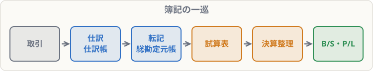

# 勘定・転記と簿記の一巡

## まず覚えること

- **勘定**とは、勘定科目ごとの増減を集計する場所。T字の形で書くので**T字勘定**ともいう。
- **転記**：仕訳の借方の金額は、その科目の勘定の**借方（左）**へ、貸方の金額は**貸方（右）**へ書き写す。相手の科目名も書く。
- 簿記の一巡：**取引 → 仕訳（仕訳帳）→ 転記（総勘定元帳）→ 試算表 → 決算整理 → 財務諸表**。

## なぜ勘定に集計するのか

仕訳は日付順の記録なので、「今、現金はいくらあるか」を知るには、全部の仕訳から現金を探して足し引きしなければなりません。そこで、**科目ごとに専用のページ（勘定）**を用意して、同じ科目の動きを集めます。全部の勘定をまとめた帳簿を**総勘定元帳**といいます。

## 転記のしかた

> 4/1 銀行から現金100,000円を借りた
> 4/5 商品30,000円を現金で仕入れた

| 借方科目 | 金額 | 貸方科目 | 金額 |
|---|--:|---|--:|
| 現金 | 100,000 | 借入金 | 100,000 |
| 仕入 | 30,000 | 現金 | 30,000 |

- 4/1の仕訳：借方「現金100,000」→ 現金勘定の**左**に「4/1 借入金 100,000」。貸方「借入金100,000」→ 借入金勘定の**右**に「4/1 現金 100,000」。
- 4/5の仕訳：仕入勘定の**左**に「4/5 現金 30,000」、現金勘定の**右**に「4/5 仕入 30,000」。

勘定に書く科目名は、**仕訳の相手側の科目**です。「何と引き換えに増えた（減った）のか」がわかるようにするためです。

現金勘定を見ると、左の合計100,000 − 右の合計30,000 ＝ **残高70,000円**。今の現金の量がすぐわかります。

## 簿記の一巡

1. **期中**（1年間の毎日）：取引を仕訳し、総勘定元帳に転記する
2. **決算**（1年の最後）：試算表で記録を確認し、決算整理をして、損益計算書・貸借対照表を作る

会社が決めた1年間を**会計期間**といい、最初の日を**期首**、最後の日を**期末（決算日）**といいます。3級の問題は、4月1日〜3月31日の会社が多いです。

## よくあるミス

- 勘定に**自分の科目名**を書いてしまう → 書くのは**相手の科目名**。
- 相手が2つ以上あるときは、科目名の代わりに**「諸口（しょくち）」**と書きます。
