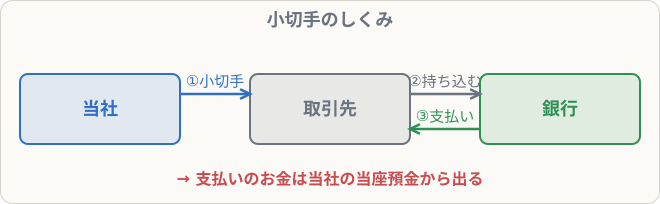

# 普通預金・定期預金・当座預金

## まず覚えること

- 預金はすべて**資産**。**普通預金・定期預金・当座預金**など、種類ごとの勘定科目を使う。
- **当座預金**は、**小切手**で支払いをするための口座。利息はつかない。
- 小切手を**振り出す（書いて渡す）**と、当座預金が減る（貸方）。

## 預金の種類

| 種類 | 特徴 |
|---|---|
| 普通預金 | いつでも出し入れ自由。給料の振込などに使う |
| 定期預金 | 一定期間引き出せないかわりに、利息が高め |
| 当座預金 | 小切手・手形の支払いに使う会社用の口座。利息なし |

複数の銀行に口座があるときは、「普通預金A銀行」のように**銀行名をつけた科目**を使うこともあります（問題文の指示に従います）。

## 普通預金・定期預金の仕訳

**普通預金から定期預金へ200,000円を預け替えた**

| 借方科目 | 金額 | 貸方科目 | 金額 |
|---|--:|---|--:|
| 定期預金 | 200,000 | 普通預金 | 200,000 |

**普通預金に利息300円が入金された**

| 借方科目 | 金額 | 貸方科目 | 金額 |
|---|--:|---|--:|
| 普通預金 | 300 | 受取利息 | 300 |

## 当座預金と小切手のしくみ

会社が小切手に金額を書いて相手に渡すと、相手はそれを銀行に持っていき、**会社の当座預金から**お金を受け取ります。大きな金額を現金で持ち歩かなくてすむので、会社でよく使われます。

**当座預金に現金500,000円を預け入れた**

| 借方科目 | 金額 | 貸方科目 | 金額 |
|---|--:|---|--:|
| 当座預金 | 500,000 | 現金 | 500,000 |

**買掛金80,000円の支払いのため、小切手を振り出した**

| 借方科目 | 金額 | 貸方科目 | 金額 |
|---|--:|---|--:|
| 買掛金 | 80,000 | 当座預金 | 80,000 |

> 小切手を振り出した時点で、当座預金が減ったものとして処理します（実際に相手が換金するのは後でも）。

**以前に自社が振り出した小切手30,000円を、売掛金の回収として受け取った**

| 借方科目 | 金額 | 貸方科目 | 金額 |
|---|--:|---|--:|
| 当座預金 | 30,000 | 売掛金 | 30,000 |

自分の小切手が戻ってきたので、当座預金が減らなかったことになります。現金ではないので注意。

## 覚え方のコツ

- 「**小切手を書いたら当座預金が減る**」。
- 「他人の小切手 → 現金」「自分の小切手 → 当座預金」をセットで覚えましょう。
