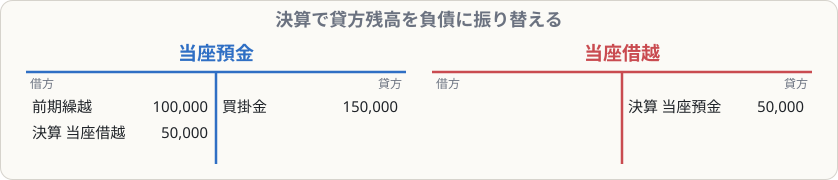

# 当座借越

## まず覚えること

- 銀行と**当座借越契約**を結んでおくと、当座預金の残高をこえて小切手を振り出せる。こえた分は**銀行からの借金**。
- 期中は当座預金の**貸方残高（マイナス）**のまま処理し、**決算で「当座借越」（負債）または「借入金」に振り替える**。
- 翌期首には、**再振替仕訳**で元に戻す。

## なぜ必要なのか

当座預金の残高が100,000円しかないのに、150,000円の支払いが必要になることがあります。当座借越契約があれば、足りない50,000円を銀行が立て替えてくれます。これは実質的に**銀行からの借金**です。

## 期中の処理

**当座預金残高100,000円のとき、買掛金150,000円を小切手で支払った（借越限度額300,000円）**

| 借方科目 | 金額 | 貸方科目 | 金額 |
|---|--:|---|--:|
| 買掛金 | 150,000 | 当座預金 | 150,000 |

当座預金は −50,000円（貸方残高）になります。期中はこのままで大丈夫です。

## 決算の処理

決算日に当座預金が貸方残高（マイナス）なら、その分は「預金」ではなく「借金」なので、**負債の科目に振り替えます**。

| 借方科目 | 金額 | 貸方科目 | 金額 |
|---|--:|---|--:|
| 当座預金 | 50,000 | 当座借越 | 50,000 |

> 問題文で「借入金勘定に振り替える」と指示があれば、「当座借越」の代わりに「借入金」を使います。

## 翌期首の再振替

翌期の最初の日に、決算の仕訳の逆を書いて元に戻します。

| 借方科目 | 金額 | 貸方科目 | 金額 |
|---|--:|---|--:|
| 当座借越 | 50,000 | 当座預金 | 50,000 |

## 覚え方のコツ

- 「**マイナスの預金は借金**」。決算で負債に振り替える、期首に戻す、の2点セット。
