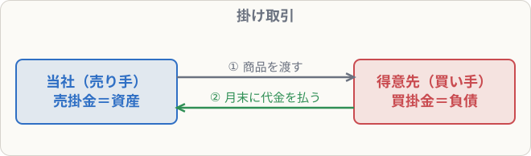

# 掛け取引と返品

## まず覚えること

- 代金を後で受け取る約束で売る → **売掛金**（資産）。後で払う約束で買う → **買掛金**（負債）。
- 返品は、**元の仕訳の逆**を書いて取り消す。
- 掛け代金を回収・支払いしたら、売掛金・買掛金を減らす。

## 掛け取引とは

会社どうしの取引では、そのたびに現金を払うのではなく、「月末にまとめて払います」という約束で取引することが多いです。これを**掛け取引**といいます。

| 立場 | 科目 | 分類 | 意味 |
|---|---|---|---|
| 売った側 | 売掛金 | 資産 | 後でお金をもらえる権利 |
| 買った側 | 買掛金 | 負債 | 後でお金を払う義務 |

## 仕訳の例

**A社から商品100,000円を掛けで仕入れた**

| 借方科目 | 金額 | 貸方科目 | 金額 |
|---|--:|---|--:|
| 仕入 | 100,000 | 買掛金 | 100,000 |

**B社に商品150,000円を掛けで売り上げた**

| 借方科目 | 金額 | 貸方科目 | 金額 |
|---|--:|---|--:|
| 売掛金 | 150,000 | 売上 | 150,000 |

**B社から売掛金150,000円が普通預金に振り込まれた**

| 借方科目 | 金額 | 貸方科目 | 金額 |
|---|--:|---|--:|
| 普通預金 | 150,000 | 売掛金 | 150,000 |

**A社への買掛金100,000円を、小切手を振り出して支払った**

| 借方科目 | 金額 | 貸方科目 | 金額 |
|---|--:|---|--:|
| 買掛金 | 100,000 | 当座預金 | 100,000 |

## 返品

### 仕入れた商品を返品した（仕入戻し）

**A社から掛けで仕入れた商品のうち、5,000円分が不良品だったので返品した**

元の仕訳「（借）仕入 ／（貸）買掛金」の**逆**を書きます。

| 借方科目 | 金額 | 貸方科目 | 金額 |
|---|--:|---|--:|
| 買掛金 | 5,000 | 仕入 | 5,000 |

### 売った商品が返品された（売上戻り）

**B社に掛けで売った商品のうち、8,000円分が返品された**

| 借方科目 | 金額 | 貸方科目 | 金額 |
|---|--:|---|--:|
| 売上 | 8,000 | 売掛金 | 8,000 |

## 覚え方のコツ

- **売**った側は**売**掛金、**買**った側は**買**掛金。
- 返品は「**なかったことにする＝逆仕訳**」。
