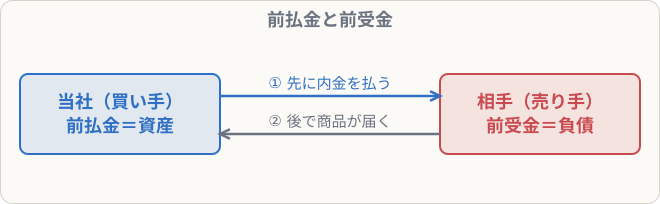

# 前払金・前受金

## まず覚えること

- 商品を受け取る**前に**代金の一部を払ったら → **前払金**（資産：後で商品をもらえる権利）。
- 商品を渡す**前に**代金の一部を受け取ったら → **前受金**（負債：後で商品を渡す義務）。
- 商品の受け渡しのときに、前払金・前受金を取り崩す。

## なぜ「仕入」や「売上」にしないのか

手付金（内金）を払った時点では、まだ商品は届いていません。**商品の受け渡しがあったときに仕入・売上を記録する**のがルールです。それまでは「商品をもらう権利」「商品を渡す義務」として記録しておきます。

## 買う側（前払金）

**C社に商品200,000円を注文し、内金20,000円を現金で支払った**

| 借方科目 | 金額 | 貸方科目 | 金額 |
|---|--:|---|--:|
| 前払金 | 20,000 | 現金 | 20,000 |

**C社から商品が届いた。残りの180,000円は掛けとした**

| 借方科目 | 金額 | 貸方科目 | 金額 |
|---|--:|---|--:|
| 仕入 | 200,000 | 前払金 | 20,000 |
|  |  | 買掛金 | 180,000 |

## 売る側（前受金）

**D社から商品300,000円の注文を受け、手付金30,000円を現金で受け取った**

| 借方科目 | 金額 | 貸方科目 | 金額 |
|---|--:|---|--:|
| 現金 | 30,000 | 前受金 | 30,000 |

**D社に商品を引き渡し、残りは掛けとした**

| 借方科目 | 金額 | 貸方科目 | 金額 |
|---|--:|---|--:|
| 前受金 | 30,000 | 売上 | 300,000 |
| 売掛金 | 270,000 |  |  |

## よくあるミス

- 注文しただけ・注文を受けただけでは**仕訳しない**（BK01-04：簿記上の取引ではない）。お金が動いたときに初めて仕訳します。
- 前払金（資産）と前受金（負債）を逆にする。**払った側＝前払金、受け取った側＝前受金**。
