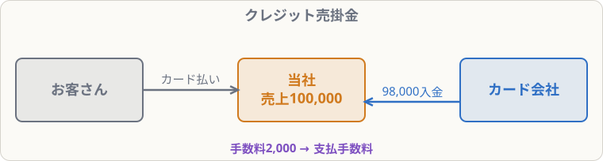

# クレジット売掛金

## まず覚えること

- お客さんがクレジットカードで支払ったら、代金は**後でカード会社から入金**される → **クレジット売掛金**（資産）。
- カード会社に払う手数料は**支払手数料**（費用）。**売り上げた時点**で計上するのが基本。
- 入金されたら、クレジット売掛金を減らす。

## なぜ普通の売掛金と分けるのか

カード払いの場合、お金を払ってくれるのは**お客さんではなくカード会社**です。お客さんに対する売掛金と区別するため、**クレジット売掛金**という科目を使います。

## 仕訳の例

**商品100,000円をクレジットカード払いで販売した。カード会社への手数料は販売代金の2％で、販売時に計上する**

| 借方科目 | 金額 | 貸方科目 | 金額 |
|---|--:|---|--:|
| クレジット売掛金 | 98,000 | 売上 | 100,000 |
| 支払手数料 | 2,000 |  |  |

- 売上は**100,000円（満額）**
- 手数料 100,000 × 2％ ＝ 2,000円は支払手数料
- 実際に入金される 98,000円がクレジット売掛金

**後日、カード会社から98,000円が普通預金に入金された**

| 借方科目 | 金額 | 貸方科目 | 金額 |
|---|--:|---|--:|
| 普通預金 | 98,000 | クレジット売掛金 | 98,000 |

## よくあるミス

- 売上を手数料差し引き後の98,000円にしてしまう → 売上は**販売価格の満額**。
- 手数料を「支払手数料」ではなく「手数料」と書く → 科目名は正確に。
