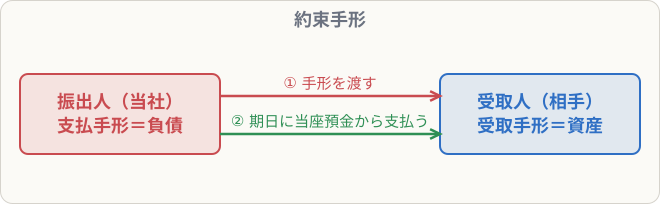

# 約束手形

## まず覚えること

- **約束手形**：「○月○日に、この金額を払います」と約束する証券。
- 手形を**振り出した（渡した）側** → **支払手形**（負債）。**受け取った側** → **受取手形**（資産）。
- 期日に当座預金で決済されたら、支払手形・受取手形を減らす。

## なぜ手形を使うのか

掛け取引は「口約束」に近いので、支払いが遅れることもあります。手形は、**支払期日と金額がはっきり書かれた証券**で、期日に払えないと「不渡り」となり会社の信用が大きく傷つきます。そのため、**掛けより確実に代金を回収できる**方法として使われてきました。

## 仕訳の例

**E社から商品200,000円を仕入れ、代金は約束手形を振り出して支払った**

| 借方科目 | 金額 | 貸方科目 | 金額 |
|---|--:|---|--:|
| 仕入 | 200,000 | 支払手形 | 200,000 |

**F社に商品300,000円を売り上げ、代金はF社振出の約束手形で受け取った**

| 借方科目 | 金額 | 貸方科目 | 金額 |
|---|--:|---|--:|
| 受取手形 | 300,000 | 売上 | 300,000 |

**支払期日に、E社に振り出した手形200,000円が当座預金から引き落とされた**

| 借方科目 | 金額 | 貸方科目 | 金額 |
|---|--:|---|--:|
| 支払手形 | 200,000 | 当座預金 | 200,000 |

**受け取っていた手形300,000円が期日に決済され、当座預金に入金された**

| 借方科目 | 金額 | 貸方科目 | 金額 |
|---|--:|---|--:|
| 当座預金 | 300,000 | 受取手形 | 300,000 |

## 覚え方のコツ

- 「**手形を出したら“支払”手形、もらったら“受取”手形**」。
- 掛けとの対応：売掛金 ↔ 受取手形（どちらも資産）、買掛金 ↔ 支払手形（どちらも負債）。
- 「振り出す」＝書いて渡す、「決済」＝実際にお金が動く。
