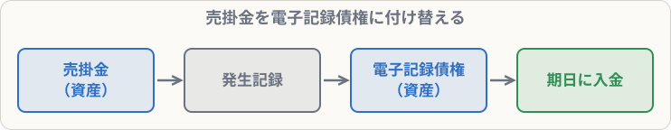

# 電子記録債権・電子記録債務

## まず覚えること

- **電子記録債権**：手形や売掛金の代わりに、**電子債権記録機関に記録**して使う債権（資産）。
- 支払う側は **電子記録債務**（負債）。
- 「**発生記録**」をしたときに、売掛金・買掛金から振り替えるのが3級の基本パターン。

## なぜ電子記録なのか

紙の手形には、作る手間、印紙税、紛失・盗難のリスクがあります。これを**電子データで記録**するようにしたのが電子記録債権です。最近は手形からの切り替えが進んでいます。

## 仕訳の例

**G社に対する売掛金100,000円について、G社の承諾を得て電子記録債権の発生記録を行った**

| 借方科目 | 金額 | 貸方科目 | 金額 |
|---|--:|---|--:|
| 電子記録債権 | 100,000 | 売掛金 | 100,000 |

**H社に対する買掛金80,000円について、取引銀行を通じて電子記録債務の発生記録を行った**

| 借方科目 | 金額 | 貸方科目 | 金額 |
|---|--:|---|--:|
| 買掛金 | 80,000 | 電子記録債務 | 80,000 |

**電子記録債権100,000円の支払期日が到来し、普通預金に入金された**

| 借方科目 | 金額 | 貸方科目 | 金額 |
|---|--:|---|--:|
| 普通預金 | 100,000 | 電子記録債権 | 100,000 |

**電子記録債務80,000円の支払期日が到来し、当座預金から引き落とされた**

| 借方科目 | 金額 | 貸方科目 | 金額 |
|---|--:|---|--:|
| 電子記録債務 | 80,000 | 当座預金 | 80,000 |

## 覚え方のコツ

- 考え方は手形とまったく同じ。**受取手形 → 電子記録債権、支払手形 → 電子記録債務**と置き換えるだけ。
- 「発生記録」＝掛けから電子記録に**付け替える**だけで、新しい売上・仕入ではありません。
