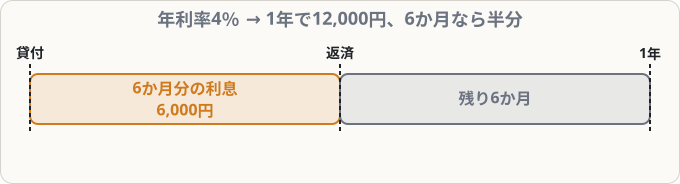

# 貸付金・借入金と利息

## まず覚えること

- お金を貸したら **貸付金**（資産）、借りたら **借入金**（負債）。
- 利息は、受け取ったら **受取利息**（収益）、払ったら **支払利息**（費用）。
- 利息 ＝ **元金 × 年利率 × 月数 ÷ 12**（3級では月割計算が基本）。

## 仕訳の例

**取引先に現金300,000円を貸し付けた（期間6か月、年利率4％、利息は返済時に受け取る）**

| 借方科目 | 金額 | 貸方科目 | 金額 |
|---|--:|---|--:|
| 貸付金 | 300,000 | 現金 | 300,000 |

**6か月後、元金と利息を現金で受け取った**

利息 ＝ 300,000 × 4％ × 6/12 ＝ **6,000円**

| 借方科目 | 金額 | 貸方科目 | 金額 |
|---|--:|---|--:|
| 現金 | 306,000 | 貸付金 | 300,000 |
|  |  | 受取利息 | 6,000 |

## 利息の計算のしかた

「年利率4％」は、**1年間借りたら4％**という意味です。6か月なら半分の2％、3か月なら4分の1の1％になります。

| 期間 | 計算 | 利息（元金300,000円・年4％） |
|---|---|---|
| 12か月 | 300,000 × 4％ × 12/12 | 12,000円 |
| 6か月 | 300,000 × 4％ × 6/12 | 6,000円 |
| 3か月 | 300,000 × 4％ × 3/12 | 3,000円 |

## 借りる側の仕訳

**銀行から500,000円を借り入れ、普通預金に入金された**

| 借方科目 | 金額 | 貸方科目 | 金額 |
|---|--:|---|--:|
| 普通預金 | 500,000 | 借入金 | 500,000 |

**借入金500,000円と利息5,000円を普通預金から返済した**

| 借方科目 | 金額 | 貸方科目 | 金額 |
|---|--:|---|--:|
| 借入金 | 500,000 | 普通預金 | 505,000 |
| 支払利息 | 5,000 |  |  |

## 役員への貸し借り

会社の**役員**（取締役など）にお金を貸したときは **役員貸付金**、役員から借りたときは **役員借入金** を使います。一般の貸付金と区別するためです。

## よくあるミス

- 利息を**1年分**で計算してしまう → 必ず「月数 ÷ 12」をかける。
- 月数の数え間違い。**4月1日〜9月30日は6か月**。指を折って数えましょう。
