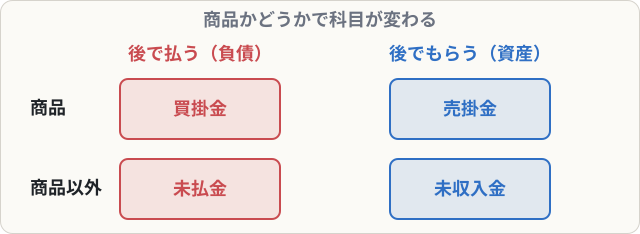

# 未収入金・未払金

## まず覚えること

- **商品以外**（備品・土地・不要品など）を、代金後払いで**買った** → **未払金**（負債）。
- **商品以外**を代金後受け取りで**売った** → **未収入金**（資産）。
- 商品の売買なら買掛金・売掛金。**「商品かどうか」で科目が変わる**。

## なぜ区別するのか

売掛金・買掛金は、会社の**本業（商品売買）**から生まれた債権・債務です。本業以外の取引から生まれたものは、別の科目で記録して、本業の取引と区別します。

## 仕訳の例

**事務用のパソコン300,000円を購入し、代金は月末に支払うことにした**

| 借方科目 | 金額 | 貸方科目 | 金額 |
|---|--:|---|--:|
| 備品 | 300,000 | 未払金 | 300,000 |

**月末に、上の代金を普通預金から支払った**

| 借方科目 | 金額 | 貸方科目 | 金額 |
|---|--:|---|--:|
| 未払金 | 300,000 | 普通預金 | 300,000 |

**不要になった段ボールを5,000円で売り、代金は後日受け取ることにした**

| 借方科目 | 金額 | 貸方科目 | 金額 |
|---|--:|---|--:|
| 未収入金 | 5,000 | 雑益 | 5,000 |

## 覚え方のコツ

| 取引 | 後で払う | 後でもらう |
|---|---|---|
| 商品 | 買掛金 | 売掛金 |
| 商品以外 | **未払金** | **未収入金** |

- 「**“掛”は商品だけ**」と覚えましょう。
- 「未払金」と「未払費用」（第11章）は別物です。混同しないように。
