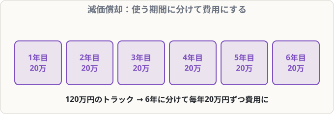
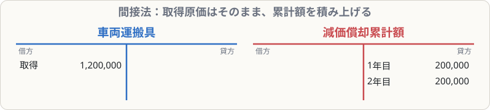

# 減価償却（定額法・間接法）

## まず覚えること

- **減価償却**：建物や備品などは、使うにつれて価値が減る。その減った分を、**毎年の費用（減価償却費）**にする手続き。
- **定額法**：1年分の減価償却費 ＝ **（取得原価 − 残存価額）÷ 耐用年数**。毎年同じ金額。
- **間接法**：固定資産の金額は減らさず、**減価償却累計額**（資産のマイナス）を貸方に積み上げる。
- 期中に買ったら、**使った月数分だけ**（月割）。土地は減価償却しない。

## なぜ減価償却をするのか

1,200,000円のトラックを買って、6年間使うとします。もし買った年に全額を費用にすると、その年だけ大赤字、残りの5年は費用ゼロになってしまいます。でも実際は、トラックは**6年間ずっと商売の役に立っています**。

そこで、**使う期間に分けて少しずつ費用にする**のが減価償却です。こうすると、毎年のもうけを正しく計算できます。

## 計算の例

**取得原価1,200,000円、残存価額0円、耐用年数6年の車両（定額法）**

1年分 ＝ （1,200,000 − 0）÷ 6 ＝ **200,000円**

> **残存価額**：使い終わったときに残る価値。問題文で「残存価額ゼロ」「取得原価の10％」などと指定されます。

## 間接法の仕訳

決算で、1年分の減価償却をする：

| 借方科目 | 金額 | 貸方科目 | 金額 |
|---|--:|---|--:|
| 減価償却費 | 200,000 | 車両運搬具減価償却累計額 | 200,000 |

**車両運搬具の金額（1,200,000円）はそのまま**で、累計額が年々増えていきます。

- 2年後：累計額400,000円 → 帳簿上の価値（帳簿価額）は 1,200,000 − 400,000 ＝ **800,000円**

> **なぜ間接法？** 取得原価と、これまでに償却した合計の両方がわかるので、「いくらで買って、どれくらい古くなったか」が一目でわかるからです。

## 期中に買ったとき（月割）

**12月1日に備品600,000円を購入（残存価額0、耐用年数5年、決算日3月31日）**

1年分 ＝ 600,000 ÷ 5 ＝ 120,000円
使った月数 ＝ 12月〜3月 ＝ **4か月**
当期の減価償却費 ＝ 120,000 × 4/12 ＝ **40,000円**

| 借方科目 | 金額 | 貸方科目 | 金額 |
|---|--:|---|--:|
| 減価償却費 | 40,000 | 備品減価償却累計額 | 40,000 |

## よくあるミス

- 月数を数え間違える。**買った月も1か月に含めます**（12月1日〜3月31日は4か月）。
- 土地を減価償却してしまう → **土地は価値が減らないので償却しない**。
- 累計額の科目名は「**備品減価償却累計額**」のように、資産名をつけて書くのが一般的。
