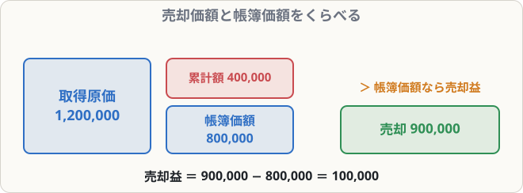

# 固定資産の売却

## まず覚えること

- 売却するときは、**固定資産**と**減価償却累計額**の両方を消す。
- **帳簿価額 ＝ 取得原価 − 減価償却累計額**。
- 売却価額 ＞ 帳簿価額 → **固定資産売却益**（収益）、売却価額 ＜ 帳簿価額 → **固定資産売却損**（費用）。

## 考え方

帳簿上「800,000円の価値がある」とされている車を、900,000円で売れたら100,000円のもうけ、700,000円でしか売れなかったら100,000円の損です。

## 仕訳の例（期首に売却）

**取得原価1,200,000円、減価償却累計額400,000円の車両を、期首に900,000円で売却し、代金は月末に受け取ることにした**

帳簿価額 ＝ 1,200,000 − 400,000 ＝ 800,000円
売却益 ＝ 900,000 − 800,000 ＝ **100,000円**

| 借方科目 | 金額 | 貸方科目 | 金額 |
|---|--:|---|--:|
| 車両運搬具減価償却累計額 | 400,000 | 車両運搬具 | 1,200,000 |
| 未収入金 | 900,000 | 固定資産売却益 | 100,000 |

> 固定資産を売って後で代金をもらうときは**未収入金**（商品ではないので売掛金ではない）。

## 期中に売却したとき

期の途中で売ったときは、**期首から売却した月までの減価償却費**を計上してから売却の処理をします。

**決算日3月31日。取得原価600,000円、累計額360,000円（年120,000円で償却）の備品を、9月30日に200,000円で売却し、現金を受け取った**

当期の減価償却費 ＝ 120,000 × 6/12 ＝ 60,000円
帳簿価額 ＝ 600,000 − 360,000 − 60,000 ＝ 180,000円
売却益 ＝ 200,000 − 180,000 ＝ **20,000円**

| 借方科目 | 金額 | 貸方科目 | 金額 |
|---|--:|---|--:|
| 備品減価償却累計額 | 360,000 | 備品 | 600,000 |
| 減価償却費 | 60,000 | 固定資産売却益 | 20,000 |
| 現金 | 200,000 |  |  |

## 解き方のコツ

1. 固定資産を**取得原価で貸方**に書いて消す
2. 累計額を**借方**に書いて消す
3. （期中売却なら）当期の減価償却費を**借方**に書く
4. 受け取ったお金を**借方**に書く
5. **左右の差額**が売却益（貸方に入るとき）か売却損（借方に入るとき）

差額で出すので、計算ミスが少なくなります。
