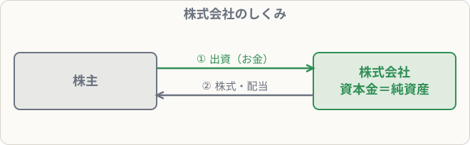

# 株式の発行と資本金

## まず覚えること

- 株式会社は、**株式を発行して出資者（株主）からお金を集める**。
- 集めたお金は、3級では原則**全額を資本金**（純資産）にする。
- 会社をつくるとき（設立）も、後から追加で発行するとき（増資）も同じ仕訳。

## 株式会社のしくみ

株主は会社にお金を出し（出資）、そのかわりに**株式**を受け取ります。会社がもうかったら、株主は**配当**を受け取れます。株主から集めたお金は**返す必要がない**ので、負債ではなく**純資産**です。

## 仕訳の例

**会社の設立にあたり、株式100株を1株あたり50,000円で発行し、全額が普通預金に払い込まれた**

50,000 × 100株 ＝ 5,000,000円

| 借方科目 | 金額 | 貸方科目 | 金額 |
|---|--:|---|--:|
| 普通預金 | 5,000,000 | 資本金 | 5,000,000 |

**増資のため、新たに株式20株を1株60,000円で発行し、払込金が当座預金に入金された**

| 借方科目 | 金額 | 貸方科目 | 金額 |
|---|--:|---|--:|
| 当座預金 | 1,200,000 | 資本金 | 1,200,000 |

## 借入金との違い

| | 借入金 | 資本金 |
|---|---|---|
| お金の出し手 | 銀行など | 株主 |
| 返す必要 | ある | ない |
| 分類 | 負債 | **純資産** |
| もうけの分け方 | 利息（決まった額） | 配当（もうけしだい） |

## 覚え方のコツ

- 「**株主のお金は返さなくていい → 純資産（資本金）**」。
- 金額は「**1株の金額 × 株数**」。
