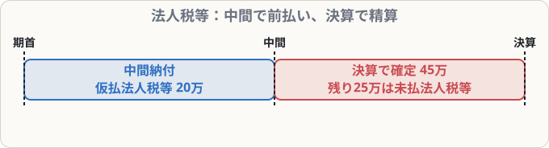

# 法人税等

## まず覚えること

- 会社のもうけにかかる**法人税・住民税・事業税**は、まとめて **法人税等** という科目で処理する。
- 期の途中で前払いする**中間申告・納付** → **仮払法人税等**（資産）。
- 決算で1年分の税額が決まったら、**法人税等**（費用）を計上し、仮払分を差し引いた残りを **未払法人税等**（負債）にする。

## なぜ中間納付があるのか

法人税は1年分のもうけで決まりますが、国は**年に1回まとめて払うと負担が大きい**ので、期の途中で半分ほどを先に納めさせます（中間納付）。この時点では1年分の金額は決まっていないので、「仮払い」として記録します。

## 仕訳の例

**① 中間申告を行い、法人税等200,000円を普通預金から納付した**

| 借方科目 | 金額 | 貸方科目 | 金額 |
|---|--:|---|--:|
| 仮払法人税等 | 200,000 | 普通預金 | 200,000 |

**② 決算で、当期の法人税等が450,000円と計算された**

| 借方科目 | 金額 | 貸方科目 | 金額 |
|---|--:|---|--:|
| 法人税等 | 450,000 | 仮払法人税等 | 200,000 |
|  |  | 未払法人税等 | 250,000 |

**③ 翌期に確定申告を行い、未払法人税等250,000円を普通預金から納付した**

| 借方科目 | 金額 | 貸方科目 | 金額 |
|---|--:|---|--:|
| 未払法人税等 | 250,000 | 普通預金 | 250,000 |

## 覚え方のコツ

- 「**前払い → 仮払、確定 → 法人税等、残り → 未払**」。
- 決算の仕訳は「**右に仮払を消して、差額を未払**」。
- 法人税等は損益計算書の最後で、税引前当期純利益から差し引かれます。
