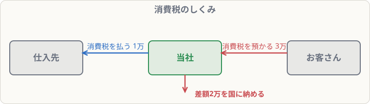

# 消費税（税抜方式）

## まず覚えること

- 3級は**税抜方式**。商品の代金と消費税を**分けて記録**する。
- 仕入などで払った消費税 → **仮払消費税**（資産）。売上で受け取った消費税 → **仮受消費税**（負債）。
- 決算で、**仮受消費税 − 仮払消費税 ＝ 納める消費税** → **未払消費税**（負債）。

## しくみ

消費税は、最終的には**お客さん（消費者）が負担する税金**です。会社は、

- 仕入のときに、仕入先に消費税を**払い**
- 売上のときに、お客さんから消費税を**預かり**
- その差額を国に納めます

会社にとっては「預かって、払った分を引いて、国に渡す」だけなので、消費税そのものは会社の費用でも収益でもありません。だから**仮払・仮受**という一時的な科目を使います。

## 仕訳の例（税率10％）

**商品100,000円（税抜）を仕入れ、消費税10,000円とあわせて掛けとした**

| 借方科目 | 金額 | 貸方科目 | 金額 |
|---|--:|---|--:|
| 仕入 | 100,000 | 買掛金 | 110,000 |
| 仮払消費税 | 10,000 |  |  |

**商品300,000円（税抜）を売り上げ、消費税30,000円とあわせて掛けとした**

| 借方科目 | 金額 | 貸方科目 | 金額 |
|---|--:|---|--:|
| 売掛金 | 330,000 | 売上 | 300,000 |
|  |  | 仮受消費税 | 30,000 |

**決算：仮払消費税10,000円、仮受消費税30,000円を相殺し、納付額を計上した**

| 借方科目 | 金額 | 貸方科目 | 金額 |
|---|--:|---|--:|
| 仮受消費税 | 30,000 | 仮払消費税 | 10,000 |
|  |  | 未払消費税 | 20,000 |

**翌期、未払消費税20,000円を現金で納付した**

| 借方科目 | 金額 | 貸方科目 | 金額 |
|---|--:|---|--:|
| 未払消費税 | 20,000 | 現金 | 20,000 |

## 覚え方のコツ

- 「**払ったら仮払、受け取ったら仮受**」。法人税等の仮払法人税等と同じ発想。
- 仕入・売上には**税抜きの金額**を書く。
