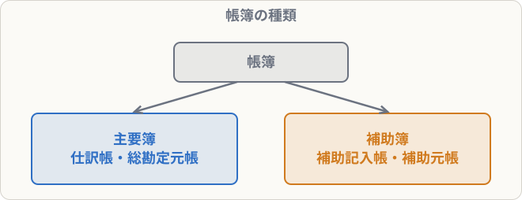

# 主要簿と補助簿

## まず覚えること

- **主要簿**：すべての取引を記録する、**仕訳帳**と**総勘定元帳**の2つ。
- **補助簿**：特定の取引や科目を、くわしく記録する帳簿。**補助記入帳**と**補助元帳**の2種類。
- 試験では「この取引は、どの補助簿に記入するか」がよく出る。**仕訳をして、出てきた科目から判断**する。

## なぜ補助簿があるのか

総勘定元帳の「売掛金」勘定を見ても、売掛金の合計しかわかりません。「A社からはいくら回収できていないか」を知るには、**得意先ごとの帳簿**が必要です。このように、主要簿だけでは足りない情報を補うのが補助簿です。

## 補助簿の一覧

| 種類 | 帳簿 | 記入する取引 |
|---|---|---|
| 補助記入帳 | 現金出納帳 | 現金の増減 |
| | 当座預金出納帳 | 当座預金の増減 |
| | 小口現金出納帳 | 小口現金の使い道 |
| | 仕入帳 | 仕入（返品も） |
| | 売上帳 | 売上（返品も） |
| | 受取手形記入帳 | 受取手形の増減 |
| | 支払手形記入帳 | 支払手形の増減 |
| 補助元帳 | 売掛金元帳（得意先元帳） | 得意先ごとの売掛金 |
| | 買掛金元帳（仕入先元帳） | 仕入先ごとの買掛金 |
| | 商品有高帳 | 商品の種類ごとの数量・単価・金額 |
| | 固定資産台帳 | 固定資産ごとの取得原価・減価償却 |

## どの補助簿に記入するか（例）

**商品50,000円を仕入れ、代金のうち20,000円は現金で支払い、残りは掛けとした**

| 借方科目 | 金額 | 貸方科目 | 金額 |
|---|--:|---|--:|
| 仕入 | 50,000 | 現金 | 20,000 |
|  |  | 買掛金 | 30,000 |

- 仕入 → **仕入帳**、商品が動いた → **商品有高帳**
- 現金 → **現金出納帳**
- 買掛金 → **買掛金元帳**

> **商品の売り買いがあったら、必ず「商品有高帳」にも記入する**（返品も含む）。ここがよく問われます。

## 覚え方のコツ

- 「**仕訳を書いて、科目ごとに帳簿を対応させる**」。暗記より確実です。
- 仕入・売上 → 商品有高帳もセット。
